# Экскурсия по Docere

Docere связывает документы пациента, работу врача и обсуждение с коллегами.
Здесь показан текущий интерфейс на синтетических данных, обновлённый 24 октября 2026 года.
Скриншоты сняты с работающего приложения. Люди, документы и клинические тексты вымышлены.

Для запуска и получения своих логинов откройте [DEMO.md](DEMO.md).
Для выступления есть отдельный [семиминутный сценарий](DEMO-PRESENTER.md).
Эта экскурсия объясняет возможности; технические настройки находятся в [руководстве разработки](DEVELOPMENT.md).

## Как устроена работа

| Объект | Для чего нужен |
|---|---|
| Карточка пациента | Хронология медицинских записей одного человека; не обязана совпадать с аккаунтом |
| Медицинская запись | Событие с датой, описанием, вложениями, автором и статусом подтверждения |
| Документ | Исходный файл записи или ещё проверяемого импорта |
| Клинический случай | Выбранные записи одного пациента, вопрос коллегам, обсуждение и итог |
| Запрос мнения | Адресованный вопрос с состоянием и связанным ответом |
| Итог | Версия результата обсуждения, сохранённая координатором |
| AI-сводка | Личная вспомогательная сводка источников; не итог координатора |

Короткий маршрут: **рабочий стол → пациент → документ → входящий запрос → ответ → итог → публикация**.

## 1. Рабочий стол и навигация

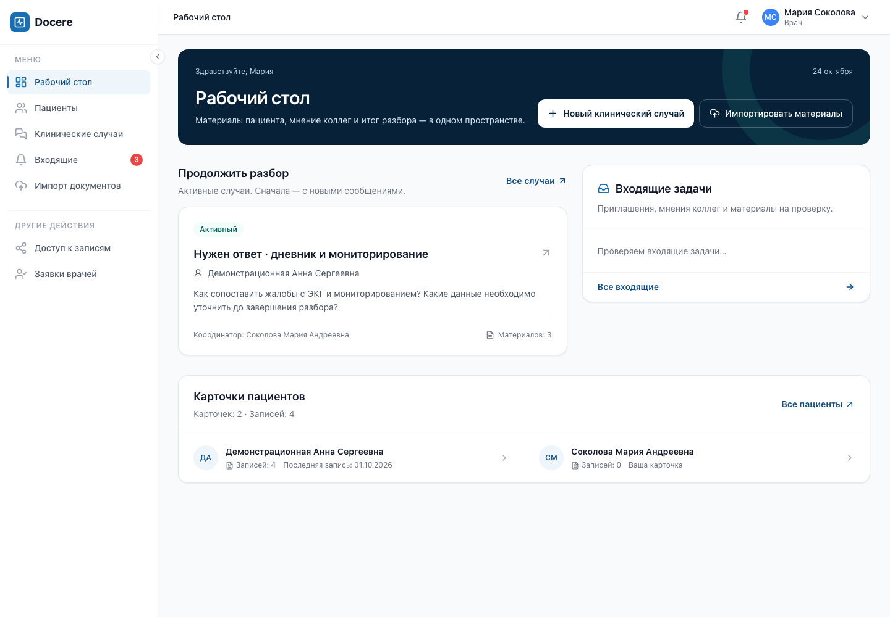

Врач видит входящие задачи, активные случаи и доступные карточки пациентов.
Можно начать разбор или импорт. Основные разделы находятся слева, управление аккаунтом — справа сверху.
Передача записей и рассмотрение заявок врачей выделены в «Другие действия».

**Попробовать:** открыть задачу или продолжить активный случай. У нового врача вместо пустых таблиц
показаны действия, с которых можно начать работу.

## 2. Пациент и медицинская история

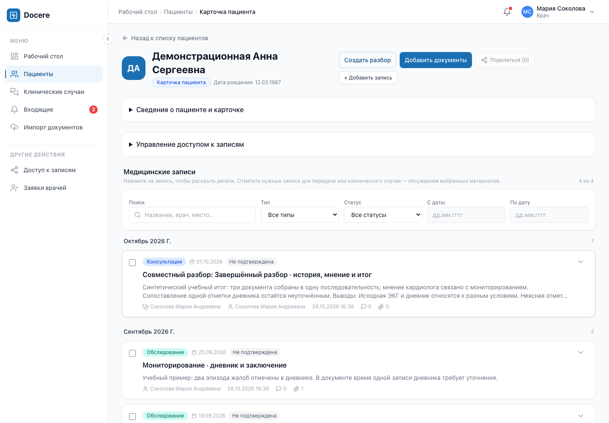

В шапке — имя и дата рождения. Кнопки «Добавить документы» и «Создать разбор» продолжают работу
в контексте выбранного пациента. «Добавить запись» позволяет создать событие вручную.
Сведения о карточке, технический идентификатор и управление доступом раскрываются отдельно.

Записи расположены по дате медицинского события, доступны фильтры и поиск. Раскрытие записи
показывает описание, вложения, профессиональные комментарии и происхождение импорта.
«Не подтверждена» и «Подтверждена врачом» — статусы записи. «Получена от коллеги» обозначает
источник доступа и не является подтверждением медицинского содержания.

**Попробовать:** раскрыть мониторирование, прочитать описание и открыть вложение.
Отмеченные записи можно включить в разбор или передать другому пользователю.

## 3. Открыть оригинал документа

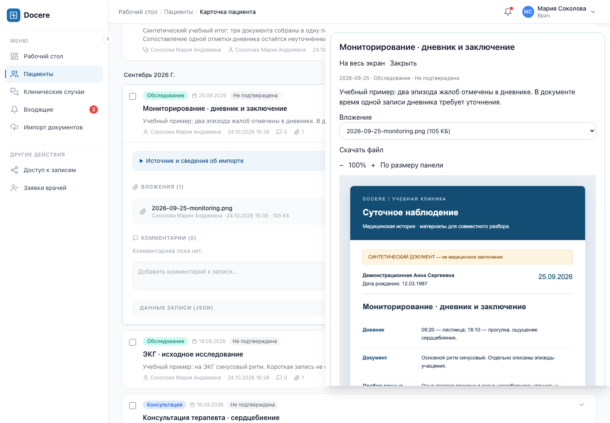

PDF открывается встроенным просмотрщиком браузера; PNG/JPEG можно увеличить, уменьшить
или вписать в панель. Есть полноэкранный просмотр, переключение вложений и скачивание.
Неподдерживаемые форматы доступны для скачивания.

Документ получается через авторизованный API. При открытии из случая дополнительно проверяются
членство и доступ ко всем материалам этого случая. Цвета исходного изображения сохраняются в обеих темах.

## 4. Загрузить документы и проверить записи

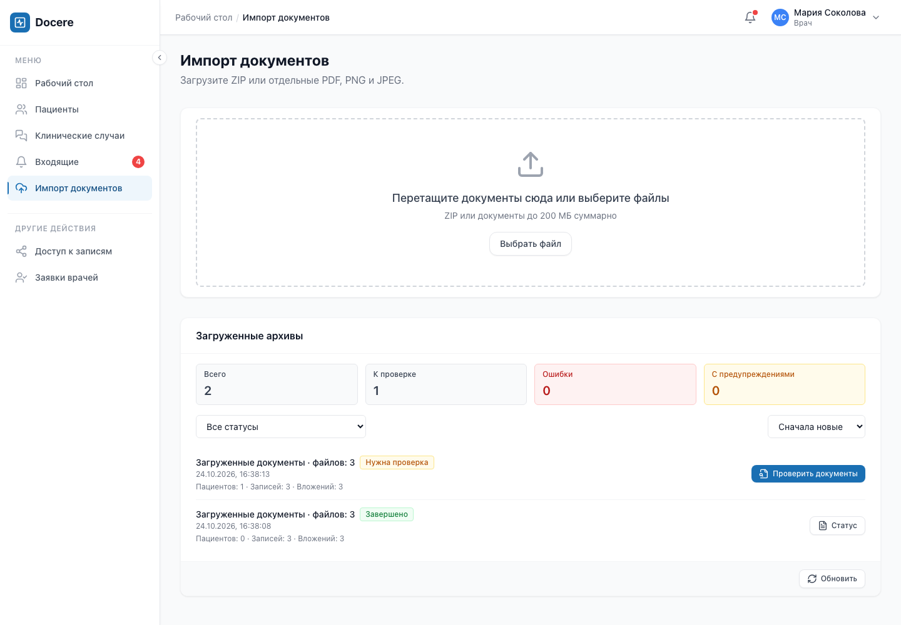

Один ZIP либо несколько PDF/PNG/JPEG создают фоновое задание. DICOM внутри архива группируется
по исследованию. После разбора открывается проверка; загрузка сама по себе не создаёт записи истории.

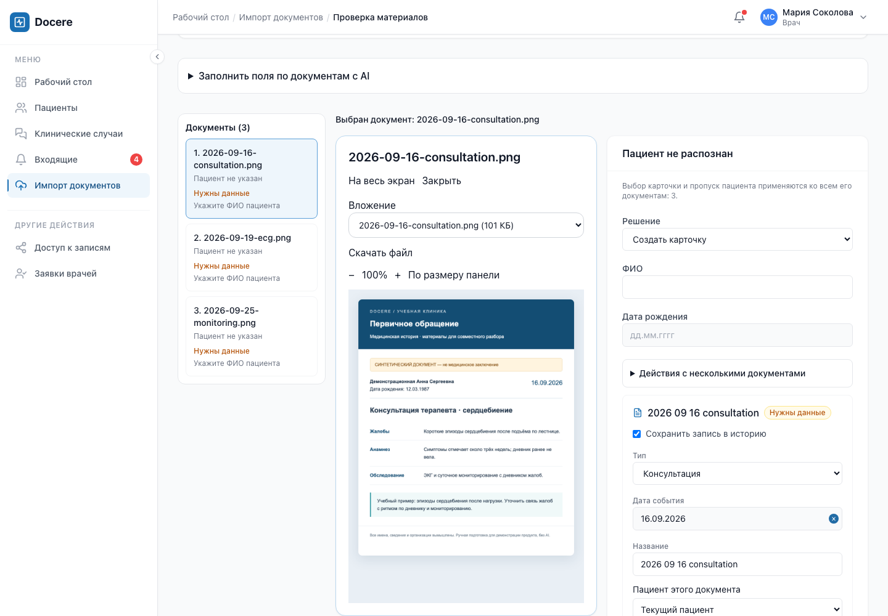

Список слева показывает документы и вопросы, которые ещё нужно решить. В рабочей области находятся
оригинал и поля только выбранной записи. Можно уточнить тип, дату, название и клиническое описание,
пропустить запись или перенести документ к другому кандидату пациента.

Выбор карты и пропуск пациента относятся ко всем его документам — область действия указана явно.
Совпадение имени не выбирает существующую карту автоматически. Возможный дубль требует решения врача.
Массовые операции доступны в раскрываемом блоке и имеют отдельный выбор документов.

**Попробовать:** изменить описание, переключить документ и вернуться. После автосохранения правки
восстанавливаются при перезагрузке. «Следующий документ» ведёт дальше; финальная кнопка показывает
число создаваемых записей. «Можно сохранить» не означает подтверждённый медицинский статус.

## 5. AI-предложения при импорте

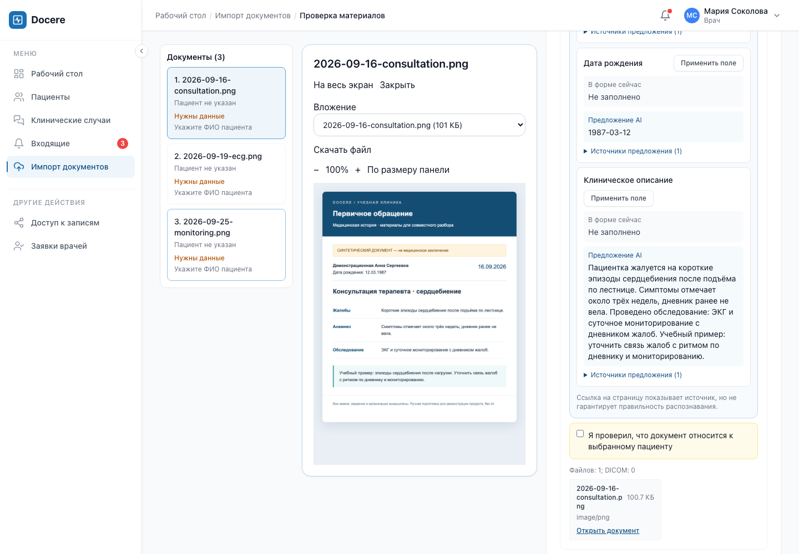

AI запускается по явному выбору пользователя и отправляет выбранные файлы настроенному внешнему сервису.
Без настройки модели ручной импорт остаётся доступным. Рядом с предложением показано текущее значение формы.
Можно применить поле, подтвердить замену непустого значения или заполнить только пустые поля.
Источники раскрываются у предложения и открывают файл на нужной странице.

Ошибки и прогресс анализа видны даже при свёрнутых настройках. Новый результат не заменяет правки врача.
Если сведения о пациенте противоречат друг другу, нужно проверить принадлежность документа.
AI не создаёт карты, не подтверждает записи и не сохраняет их вместо врача.

На этом скриншоте показан сохранённый реальный ответ модели. Формулировку «Проведено обследование»
следует проверить: исходное «Обследование: …» само по себе не доказывает выполнение.
Ссылка на источник помогает сверке, но не гарантирует правильность распознавания.
Подключение и ограничения: [AI.md](AI.md).

## 6. Создать клинический случай

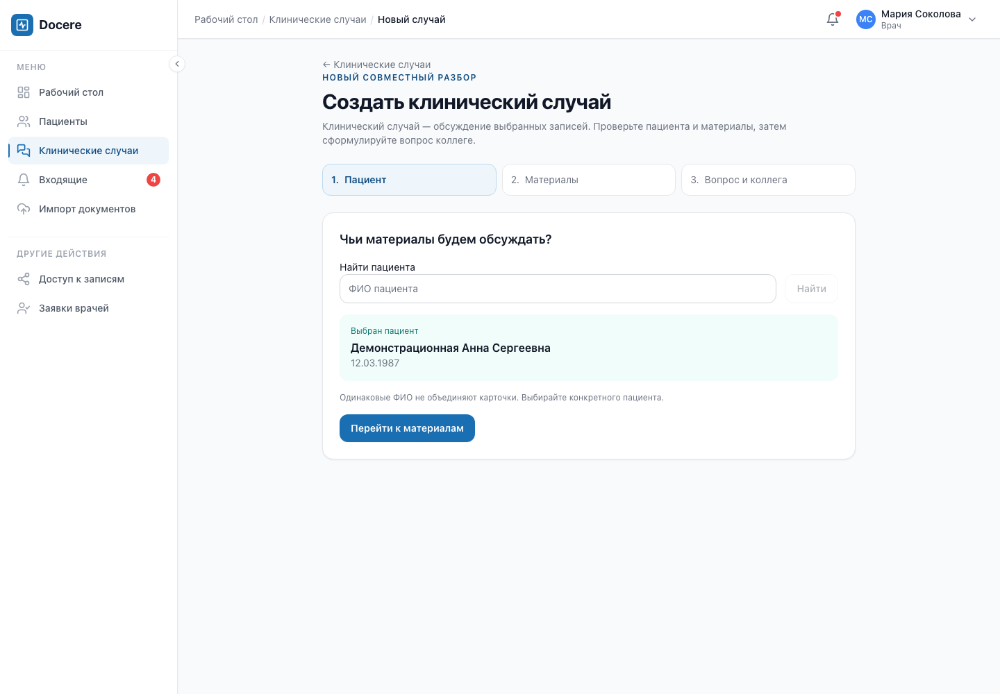

Мастер ведёт через пациента, выбор доступных записей и вопрос для коллеги.
Создатель становится координатором. До приглашения это личный черновик;
после первого приглашения начинается активный разбор.

Участие не открывает всю медицинскую историю. Координатор может добавлять материалы,
видя, каким участникам они станут доступны. Независимый доступ к записи не даёт доступа к обсуждению.

## 7. Входящие: найти задачу

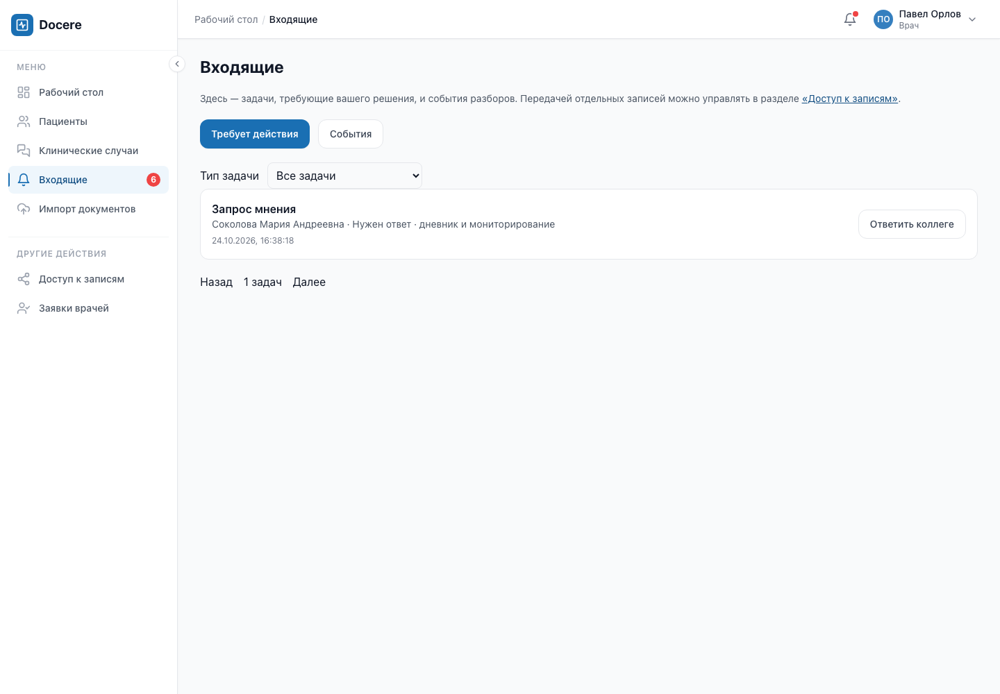

«Требует действия» объединяет приглашения, запросы мнения, независимые доступы и импорты на проверке.
«События» показывает произошедшие изменения. Прочтение события не выполняет связанную задачу.
Фильтры и страница сохраняются в адресе; на рабочем столе видны первые задачи.

До принятия приглашения коллега видит координатора, число материалов и условия участия.
Пациент, документы, клинический вопрос и обсуждение становятся доступны после принятия.

## 8. Ответить коллеге в контексте вопроса

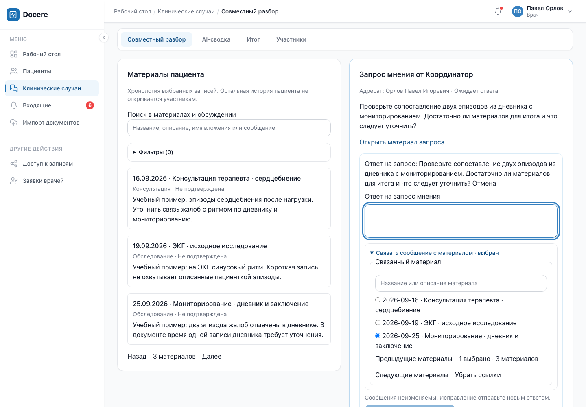

«Ответить коллеге» открывает конкретный запрос, его вопрос, источник и поле «Ответ на запрос мнения».
Не нужно искать его на одной из страниц списка. «Открыть материал запроса» показывает исходник;
«Отправить ответ на запрос» связывает сообщение с вопросом и отмечает его отвеченным.

Обычное сообщение имеет отдельную подпись. Оно не закрывает адресованный вопрос автоматически.
Если уже есть другой личный черновик, приложение не переназначает его молча: потребуется явное решение.
Черновики сообщения, запроса и итога сохраняются на сервере на семь дней и доступны только автору
при сохранённом доступе к случаю.

В разделе материалов простой поиск остаётся видимым, фильтры раскрываются с количеством применённых условий.
Обсуждение поддерживает ссылки на материалы и один уровень ответов. Отправленное сообщение неизменяемо;
исправление оформляется новым ответом. Журнал действий раскрывается отдельно.

## 9. Личная AI-сводка случая

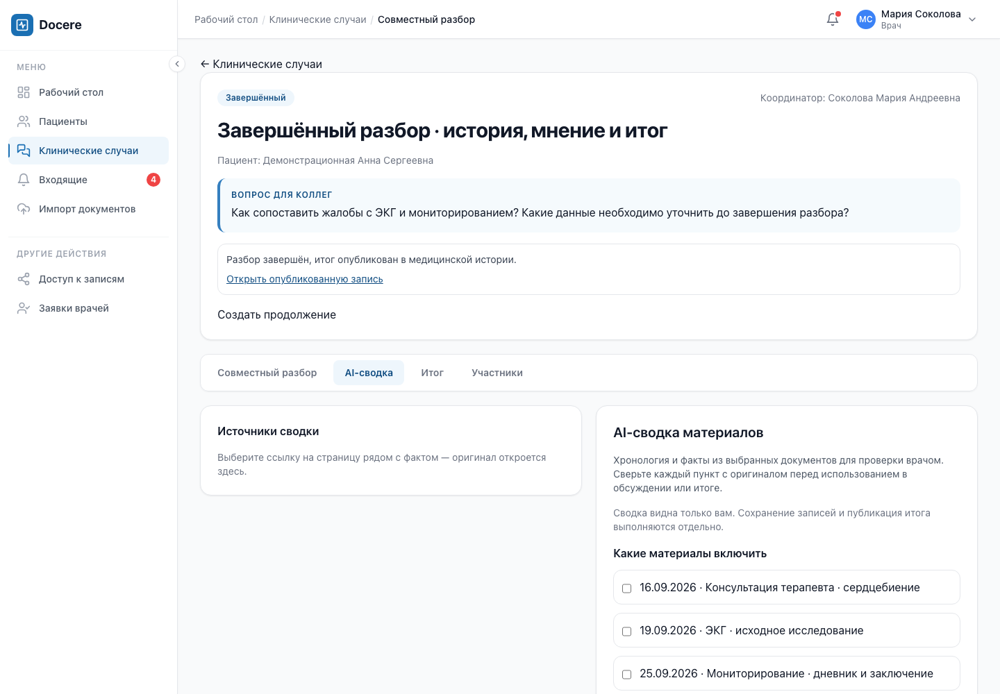

Во вкладке «AI-сводка» врач выбирает записи и разрешает внешнюю обработку их поддерживаемых исходников.
Действие «Составить сводку материалов · AI» создаёт личный вспомогательный результат.
Факты связаны с исходными документами и страницами; источник открывается через защищённый API случая.

Сводка не меняет обсуждение, итог или историю. Коллеги готовят собственные результаты.
На экране показан выбор синтетических источников для нового запуска; при обновлении скриншотов
анализ не запускался. Ранее выполненная проверка результата описана в
[датированном отчёте](reviews/2026-10-23-demo-ai.md). Проверка фактов врачом обязательна.

## 10. Сохранить итог, завершить, опубликовать

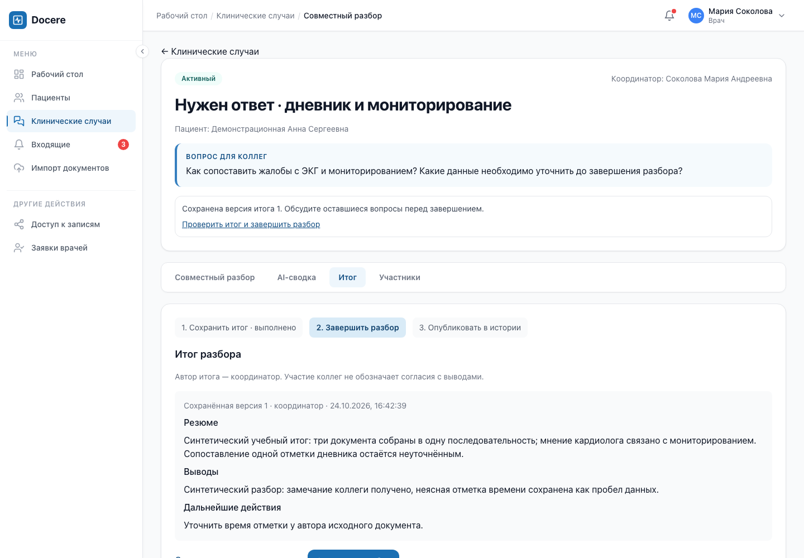

Координатор заполняет резюме, выводы и дальнейшие действия, выбирает материалы-источники
и сохраняет версию. Последняя версия видна сразу; предыдущие раскрываются и загружаются страницами.
Личный черновик отделён от сохранённого результата. Участие врача не обозначает согласия с выводами.

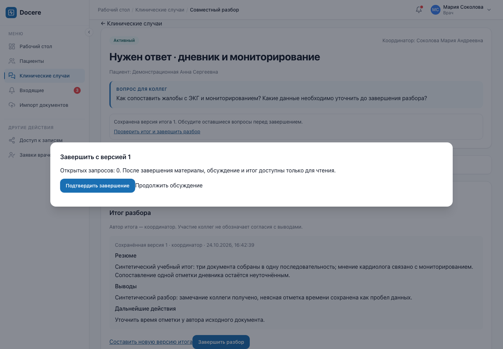

Перед завершением показаны версия итога и незавершённые запросы. Координатор либо продолжает обсуждение,
либо явно отменяет открытые запросы. Отличающийся личный черновик нельзя потерять молча:
его нужно сохранить или явно выбрать уже сохранённую версию. Закрытый случай остаётся доступным для чтения.

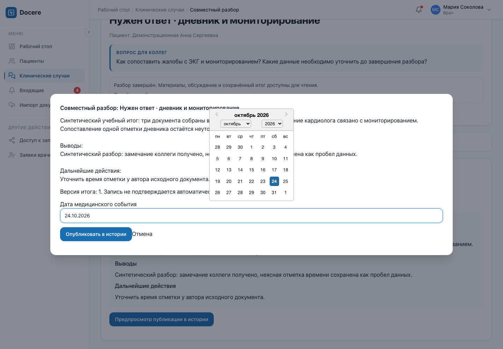

Публикация — отдельное действие с предпросмотром и обязательной датой медицинского события.
Повторный запрос возвращает существующую запись, не создавая дубликат.

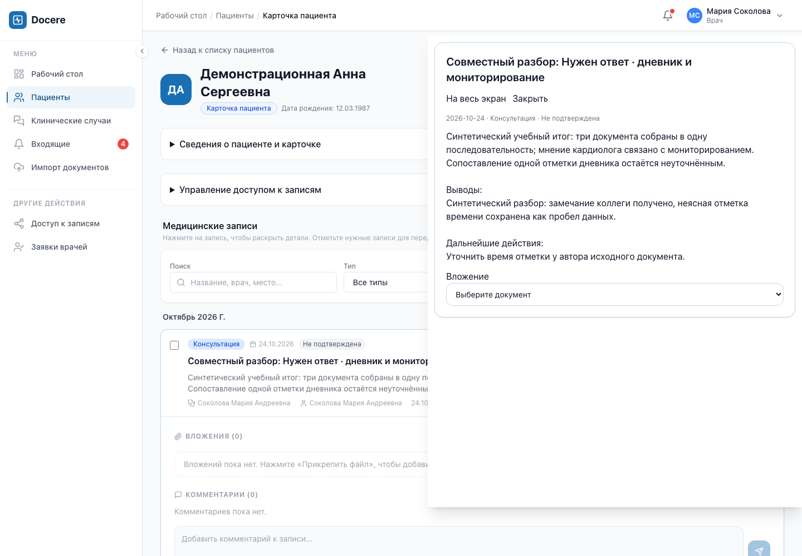

«Открыть опубликованную запись» ведёт прямо к результату. Запись самостоятельна:
отзыв доступа к исходникам не удаляет её, но ссылки на исходники всё равно проверяют права.
Подтверждение и бессрочный доступ всем участникам автоматически не выдаются.

## 11. Передать записи независимо от разбора

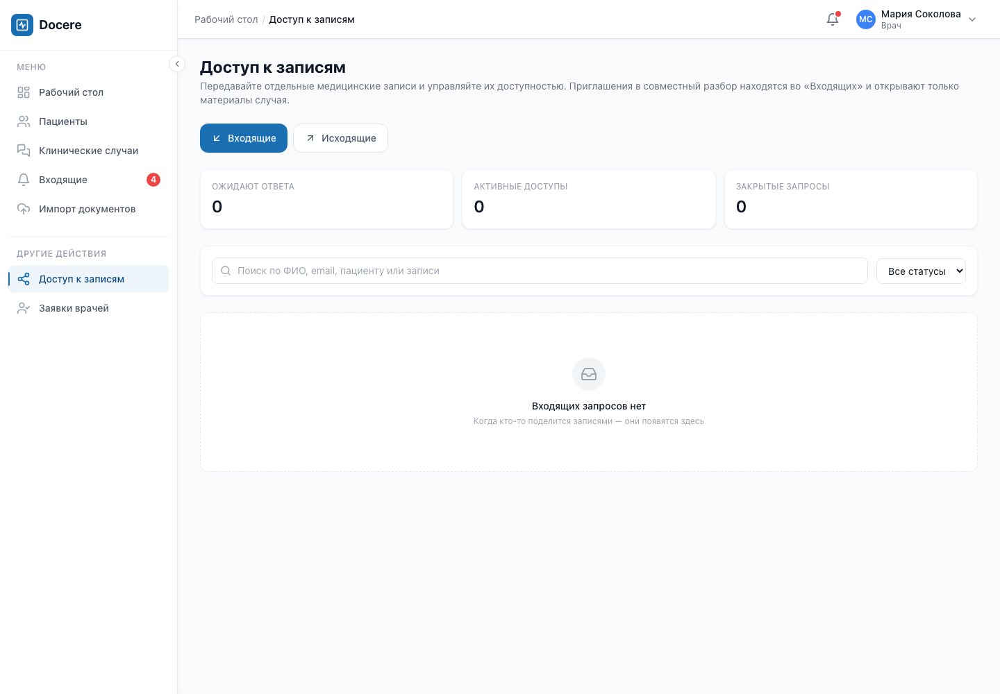

В истории выбираются конкретные записи и получатель; можно указать срок. Получатель принимает
или отклоняет доступ. Отправитель может отменить приглашение или отозвать действующий доступ.
Это самостоятельная передача записей, которая не приглашает получателя в обсуждение случая.

Отзыв учитывает повторные передачи. Если основание исчезло, зависимые передачи отзываются;
другое независимое право на ту же запись сохраняется. В карточке пациента управление доступом
раскрывается отдельно и не вытесняет хронологию.

## 12. Пациент, профиль и заявки врачей

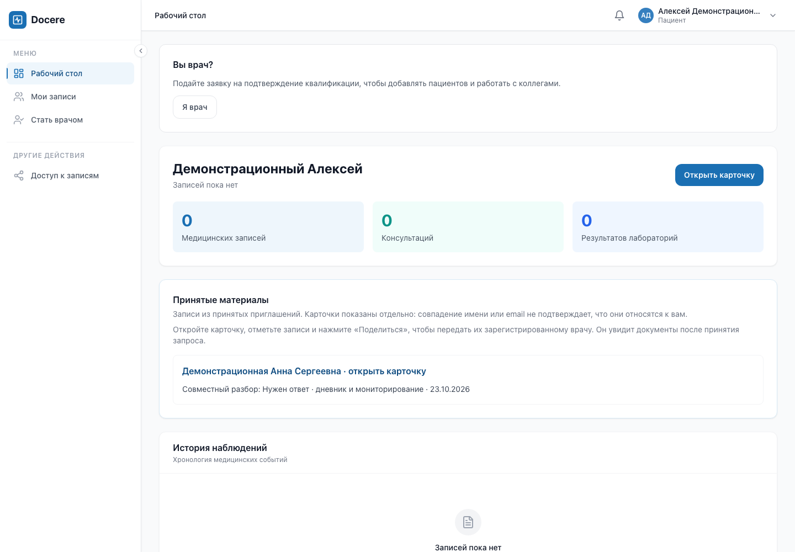

Пациент видит собственную историю и отдельно принятые материалы. Чужая карточка не объединяется
с собственной по совпадению имени. Можно работать с доступными записями и подать заявку на роль врача.

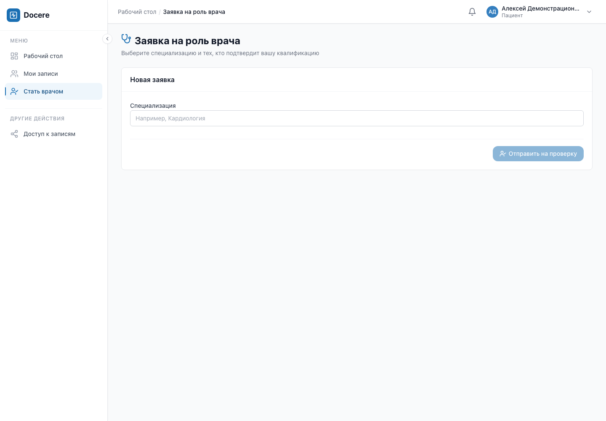

Заявка требует специализации и проверяющих; простая смена поля профиля не выдаёт роль.
Её одобряет администратор либо два разных подтверждённых врача той же специализации.
Врачи с правом рассмотрения находят заявки в «Других действиях» с отдельным счётчиком.

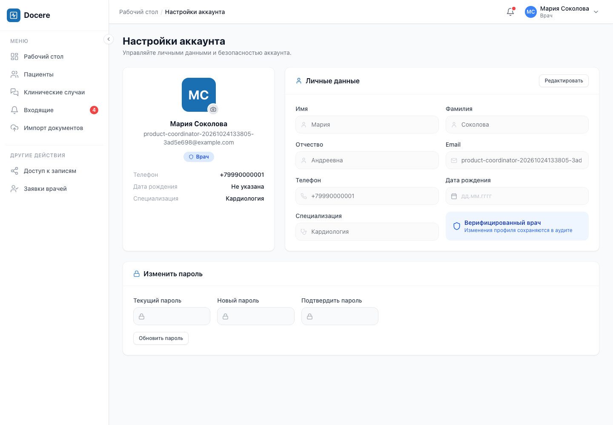

Профиль и выход находятся в меню аккаунта справа сверху. Настройка темы локальна для браузера.

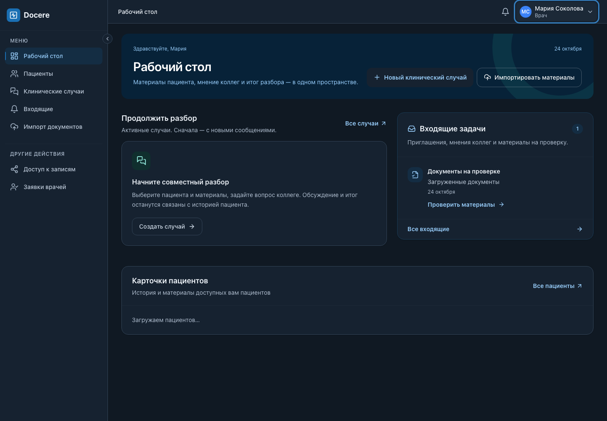

## 13. Администратор

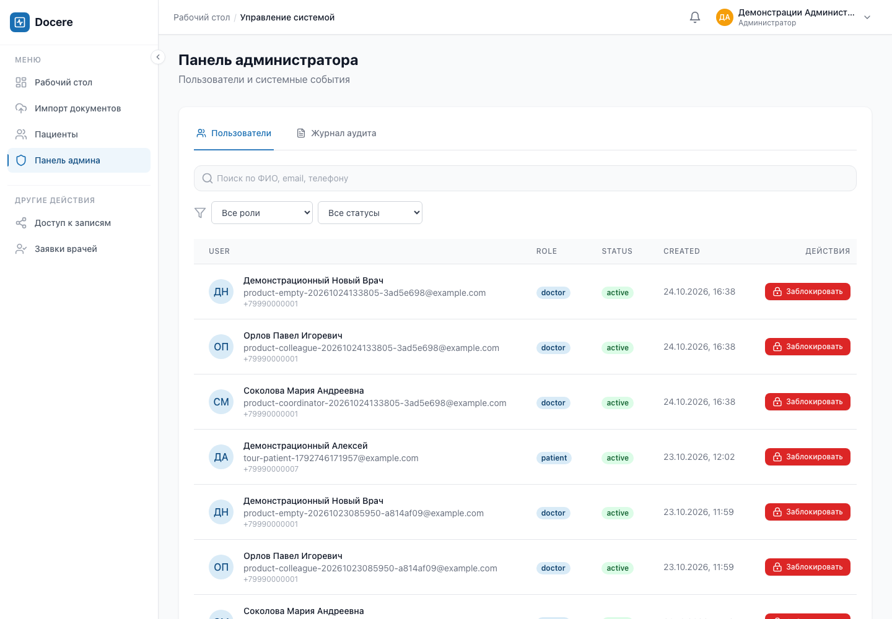

Администратор управляет пользователями и рассматривает заявки. Журнал показывает значимые действия,
включая операции с записями, доступом и импортом. Изменение профиля подтверждённого врача аудируется.

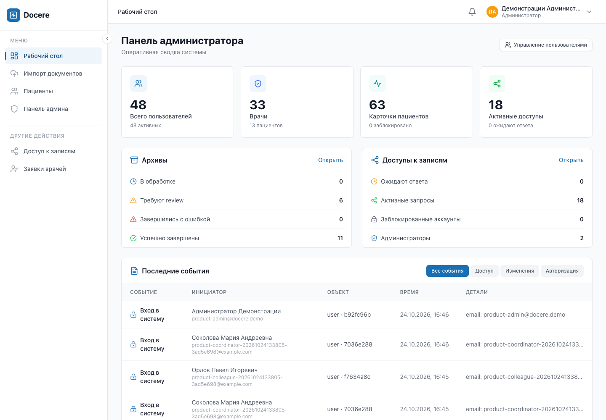

## Что проверено

Основной сценарий в этой версии выполнен через интерфейс на отдельном синтетическом наборе:
входящие → исходник → ответ коллеги → итог → закрытие → публикация с датой 24 октября.
Проверены посторонний врач, отзыв доступа, режим чтения закрытого случая, сохранность текста при
управляемом сетевом сбое и успешный повтор. Импорт с переносом/пропуском проверен отдельно.

Экранные состояния сняты на работающем локальном приложении. Подготовленные записи и аккаунты
созданы публичным API; AI-результаты сохранены от отдельной реальной проверки подключения.
Ни точность модели на произвольных документах, ни востребованность у врачей этими скриншотами не доказаны.
Следующая пользовательская проверка проводится по [PRODUCT-VALIDATION.md](PRODUCT-VALIDATION.md).
