# Docere — от документа пациента к совместному решению

**Наглядная экскурсия по работающему приложению.**

Docere — рабочее пространство для медицинской истории и совместного разбора случаев.
Врач собирает документы, проверяет предложенные AI поля, привлекает коллегу и сохраняет результат.
Пациент управляет доступными ему записями; администратор управляет пользователями и видит журнал действий.

> Здесь настоящие скриншоты локального приложения от **23 октября 2026 года**.
> Все люди, документы и клинические тексты вымышлены. Это демонстрация функций, а не медицинские рекомендации.
> Основной сценарий пройден через браузер за двух врачей, включая ответ, завершение и публикацию.

## Сначала — как устроен продукт

| Что | Простыми словами | Где открыть |
|---|---|---|
| Карточка пациента | История с записями и оригиналами документов | **Пациенты** |
| Импорт | Подготовка новых записей из файлов; врач проверяет их перед сохранением | **Импорт документов** |
| Клинический случай | Отдельный разбор: выбранные записи, вопрос, коллеги, обсуждение и итог | **Клинические случаи** |
| Входящие | Что требует ответа или проверки и что недавно произошло | **Входящие** |
| Доступ к записям | Передача конкретных записей другому пользователю | **Доступ к записям** |

**Два разных применения AI:**

- **При импорте** — предлагает поля будущей записи: имя, даты, название, тип, описание.
- **Внутри случая** — извлекает факты из выбранных документов, чтобы врачу было проще их просмотреть.

AI-предложения, сообщение коллеги и сохранённый итог — разные объекты.
AI сам не завершает разбор и не публикует медицинские записи.

### Если смотреть только пять минут

Посмотрите разделы **1 → 4 → 5 → 8 → 10 → 12 → 13**.
Остальные разделы — подробности и дополнительные возможности.

---

## 1. Рабочий стол: понять, что делать дальше

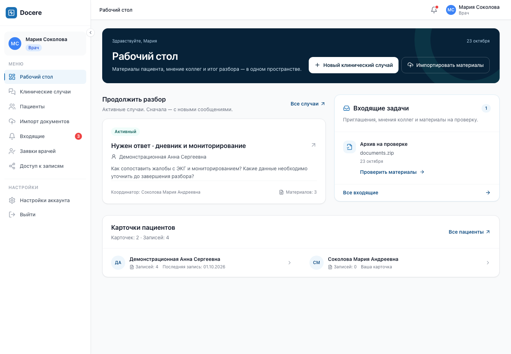

**Задача врача:** вернуться к незавершённому разбору или увидеть новое поручение.

- В центре — разборы, к которым можно вернуться.
- Справа — входящие задачи с действием.
- Ниже — быстрый переход к карточкам пациентов.
- «Новый клинический случай» начинает совместный разбор.

**Попробовать:** нажать название активного разбора или задачу «Ответить коллеге».

**Фраза для презентации:** «Врач начинает с текущей работы: кому ответить и какой разбор продолжить».

## 2. Пациенты: найти нужную историю

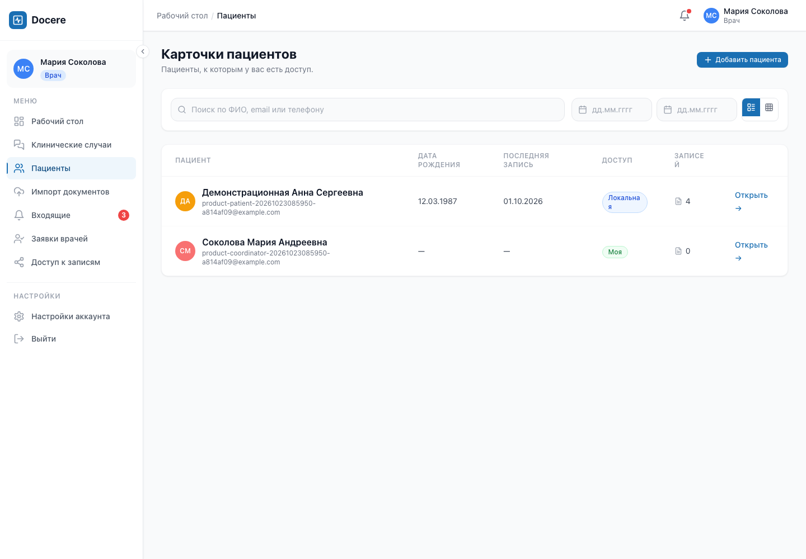

Здесь доступны поиск, фильтры и создание карточки. Врач работает с доступными ему пациентами.
Карточка, созданная врачом, может существовать без регистрации самого пациента в Docere.
Совпадение имени или email не объединяет автоматически разные карточки.

**Попробовать:** открыть «Демонстрационная Анна Сергеевна».

## 3. История: собрать документы в последовательность событий

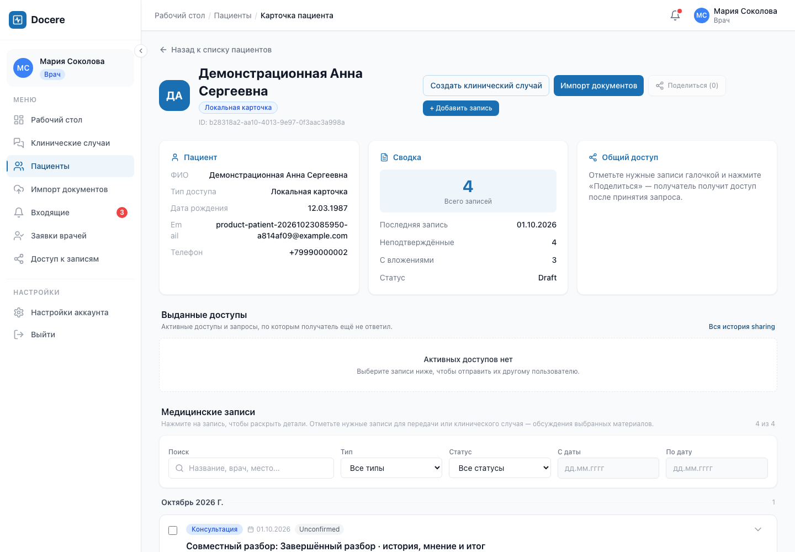

Карточка объединяет консультации, обследования, анализы и другие записи.
У записи есть дата медицинского события, тип, описание, вложения и состояние подтверждения.
Можно искать и фильтровать записи, добавлять их вручную или импортировать документы.

**Попробовать:** раскрыть консультацию или мониторирование; изменить фильтр типа записи.

**Важно:** «Не подтверждена» не означает, что документ отсутствует. Это отдельный статус проверки записи.

### Запись можно добавить вручную

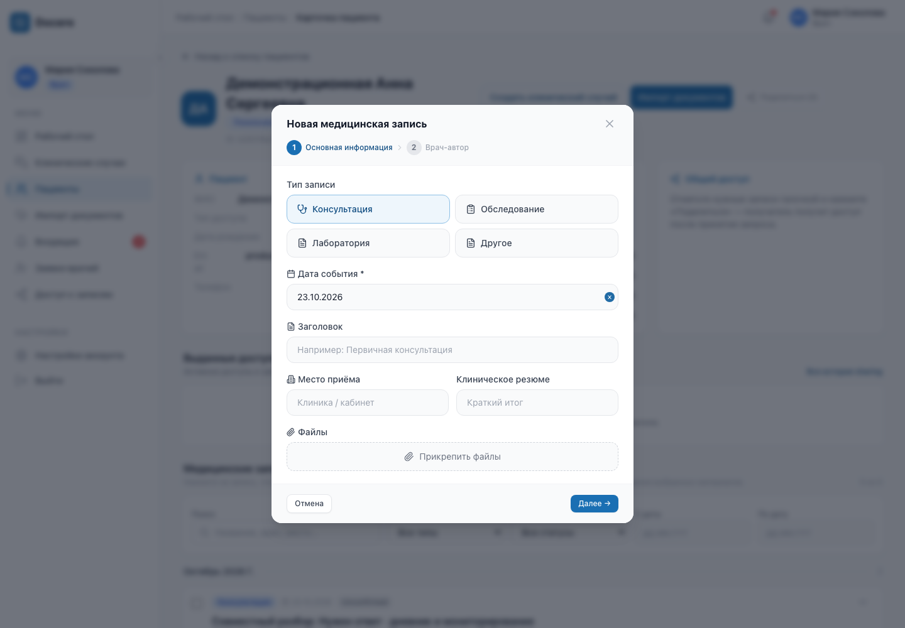

Кнопка **«+ Добавить запись»** открывает форму с типом, датой, названием,
описанием, сведениями о специалисте и вложениями. Импорт не является обязательным способом ведения истории.

### У записи есть детали и комментарии

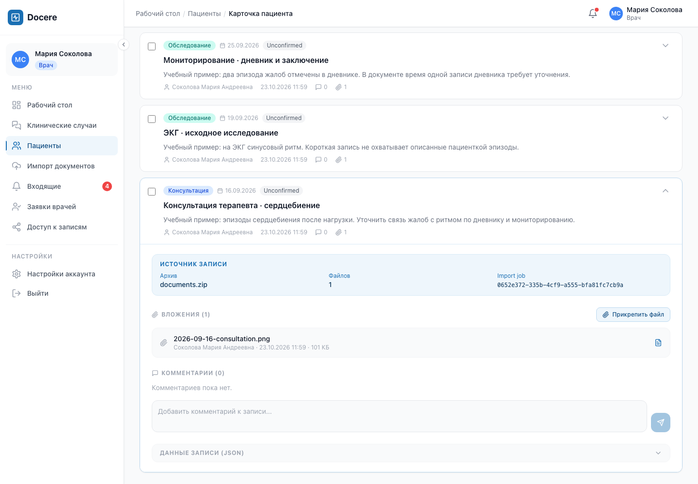

Комментарии к одной медицинской записи помогают уточнить её содержимое.
Обсуждение клинического случая хранится отдельно: оно может относиться сразу к нескольким материалам.

## 4. Просмотр документа: сверить запись с исходником

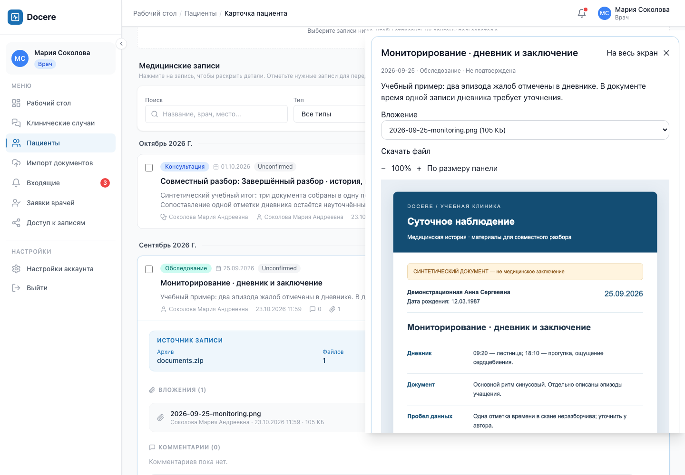

Поддерживаемый документ открывается внутри приложения. Есть переключение вложений,
масштабирование изображения, полноэкранный режим и скачивание. PDF открывается встроенным просмотрщиком;
для остальных форматов доступно скачивание.

В истории пациента исходник открывается по имени вложения. В проверке импорта используйте
«Открыть документ»: панель показывает выбранный файл; на телефоне кнопка «Поля записи»
возвращает к редактированию. Это просмотр загруженного файла, а не новая копия медицинской записи.

**Попробовать:** раскрыть мониторирование → нажать имя PNG → увеличить изображение.

**Фраза:** «Описание не заменяет оригинал: врач может сразу сверить сведения с документом».

## 5. Импорт и AI: из файла — в проверенную запись

**Обновление интерфейса, 24 октября:** проверка теперь показывает один выбранный документ.
Слева — список, в рабочей области — оригинал и поля этой записи. На телефоне переключайте
«Документ / Поля записи». Правки остальных документов остаются в черновике.

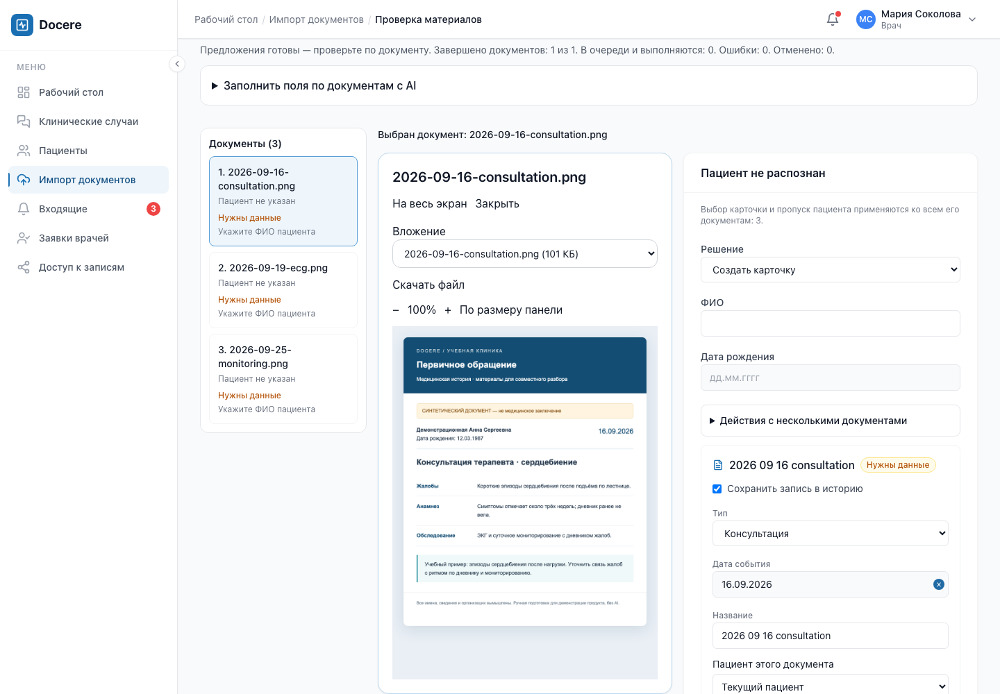

В предложении AI отдельно видны текущее значение и предложенное. Пустые поля можно заполнить
вместе, замену введённого значения нужно подтвердить. Источник раскрывается под предложением.
Итоговое действие — «Сохранить N записей в историю»; перед ним система проверяет обязательные
данные и возможные дубли. Следующие скриншоты также показывают предыдущую компоновку экрана.

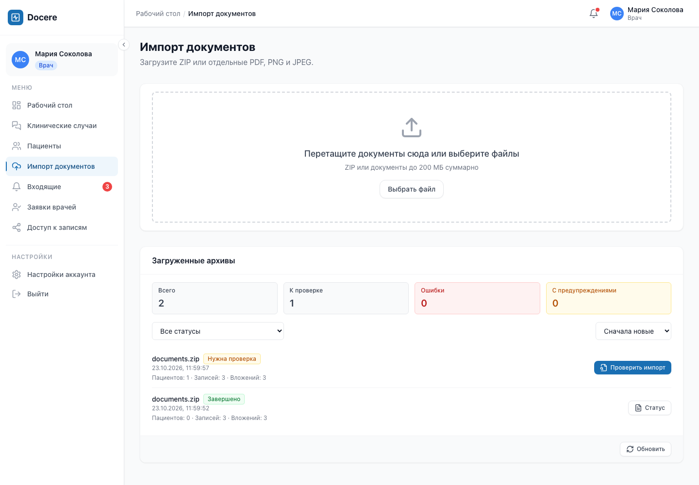

**Путь:** «Импорт документов» → выбрать ZIP либо PDF/PNG/JPEG → при желании включить анализ AI → проверить материалы.
Архивы обрабатываются в фоне; список импортов позволяет вернуться к незавершённой проверке.

До финального сохранения врач выбирает пациента, проверяет группы документов, даты и типы записей.
Можно пропустить ненужные группы; потенциальные дубликаты требуют внимания.

### AI предлагает, врач применяет

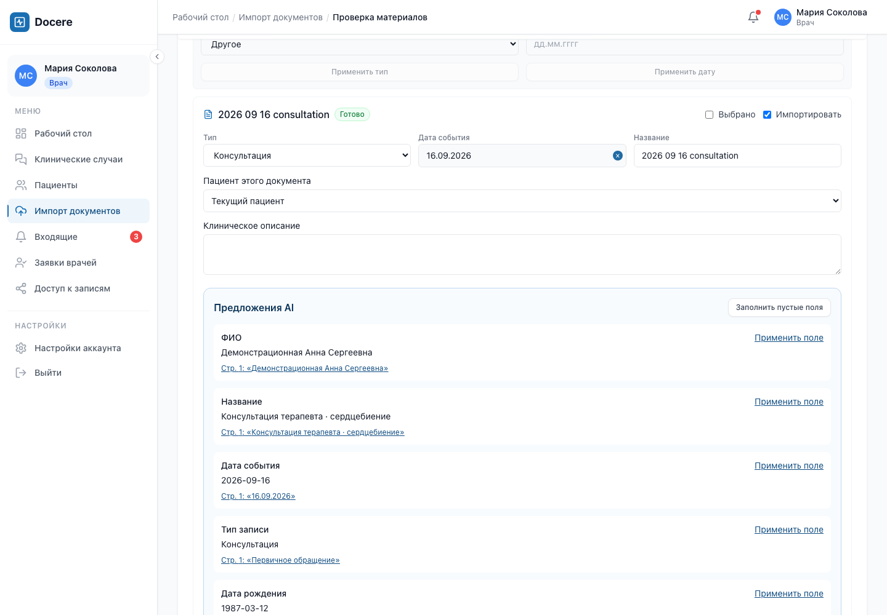

На скриншоте — **настоящий результат Qwen3.5-122B-A10B** для синтетического изображения консультации.
Модель предложила имя, дату рождения, дату события, тип, название и описание.

- **«Применить поле»** переносит одно предложение в форму.
- **«Заполнить пустые поля»** помогает заполнить незаполненные значения.
- Повторный анализ не должен подменять ручную правку врача.
- Можно анализировать выбранные файлы уже на экране проверки.

**Попробовать:** открыть готовую проверку из раздела «Ссылки для самостоятельного теста» ниже.

### Каждое предложение нужно сверить

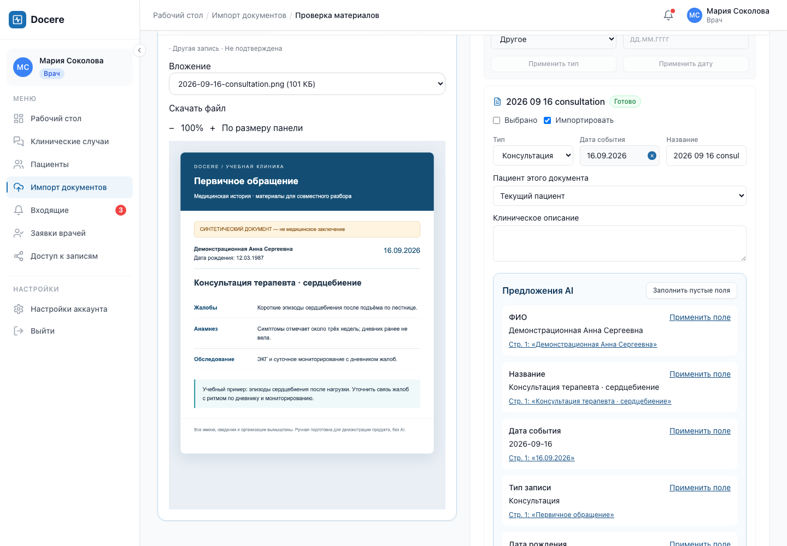

Нажатие **«Стр. 1: …»** открывает исходник рядом с формой.
Врач может проверить, откуда взялось значение, и исправить его до сохранения.

**Реальный пример ошибки этого анализа:** исходник содержит строку «Обследование: ЭКГ…»,
а AI написал «Проведено обследование». Исходник не подтверждает факт выполнения.
Корректнее оставить «В документе указаны ЭКГ и суточное мониторирование».

**Фраза:** «Мы сокращаем ручное заполнение, но оставляем проверку и сохранение человеку».

> AI работает через внешний сервис. Перед отправкой документов это явно указано в интерфейсе.
> Здесь использовались только вымышленные материалы. Одна успешная демонстрация не доказывает качество на любых документах.

## 6. Создание разбора: пациент → материалы → вопрос

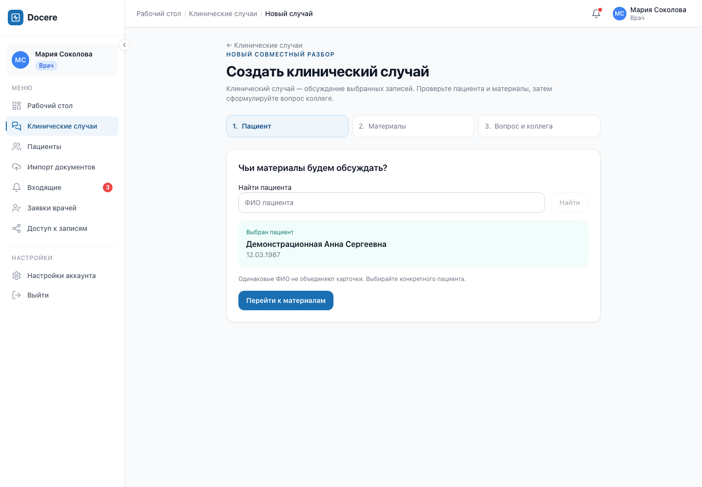

Создание начинается из карточки пациента или раздела «Клинические случаи».
Врач выбирает пациента, конкретные материалы и формулирует вопрос.

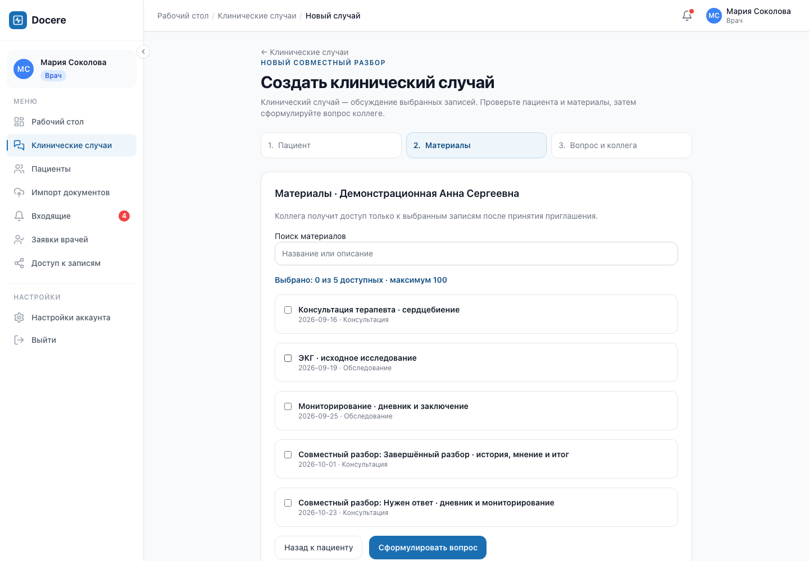

В разбор включаются выбранные записи. Членство в разборе не открывает всю историю пациента.

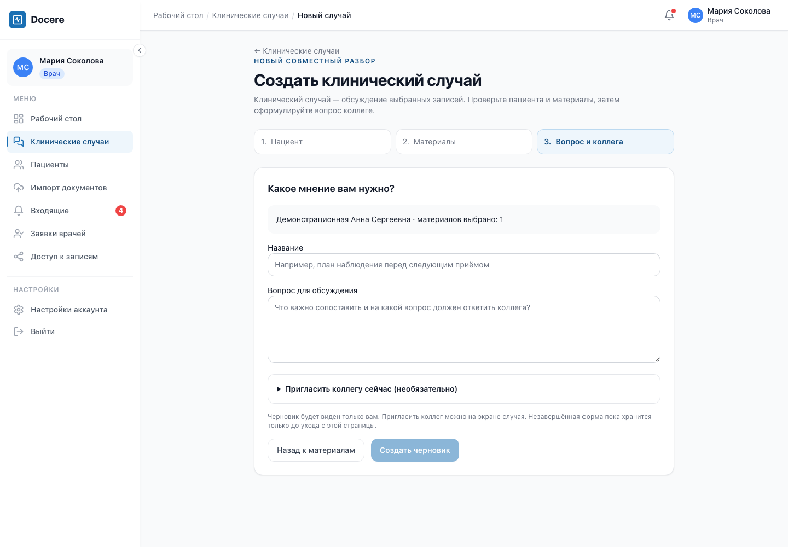

Можно сохранить черновик или найти зарегистрированного врача и отправить приглашение.
До принятия приглашения клинические сведения недоступны получателю.

**Пример вопроса:** «Как сопоставить жалобы с ЭКГ и мониторированием? Какие данные нужно уточнить?»

## 7. Совместное рабочее пространство

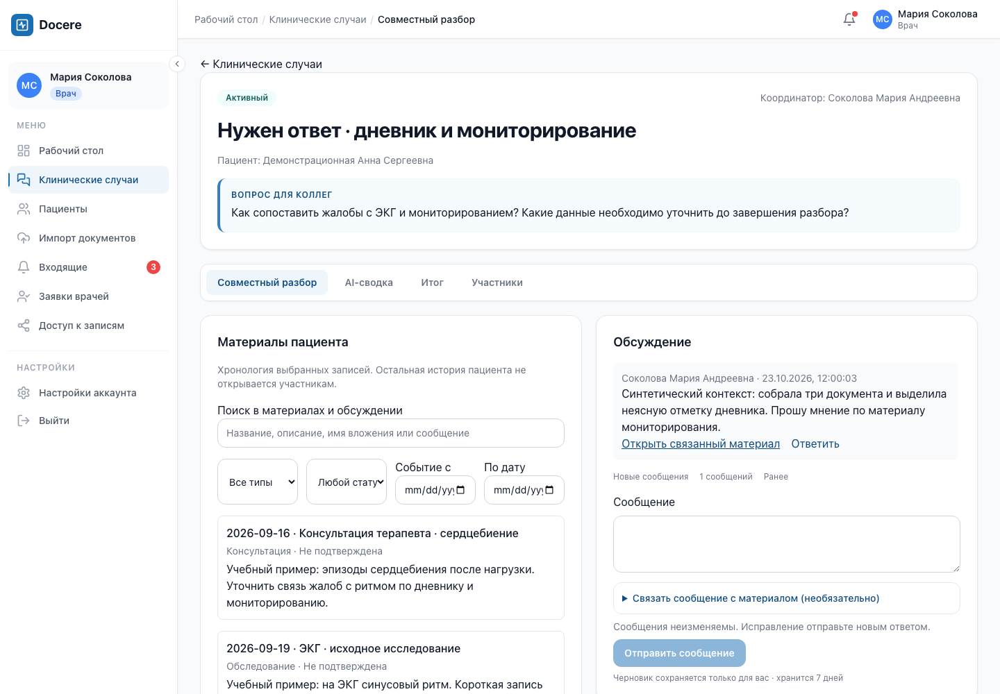

- В шапке — клинический вопрос и состояние разбора.
- Слева — выбранные материалы с поиском и фильтрами.
- Справа — обсуждение и запросы мнения.
- Ссылка из сообщения ведёт к соответствующему материалу.
- Итог, участники и AI-сводка вынесены во вкладки.

**Попробовать:** открыть связанный материал из сообщения и вернуться к обсуждению.

### Кто участвует и что ему доступно

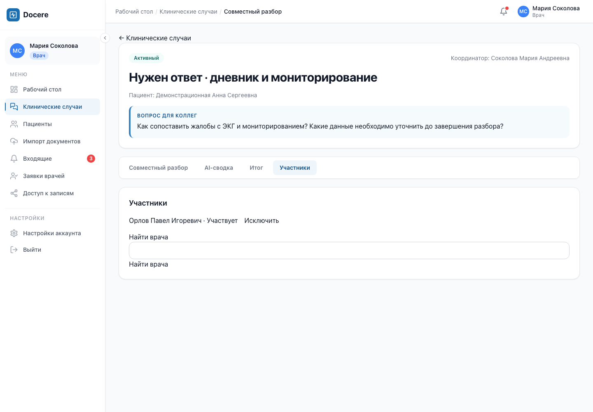

Создатель — координатор. Он приглашает коллег, добавляет материалы, сохраняет итог и завершает разбор.
Участник может выйти; координатор может исключить участника.
Права, полученные через случай, отзываются отдельно от независимого доступа к тем же записям.

## 8. AI-сводка: извлечённые факты с источниками

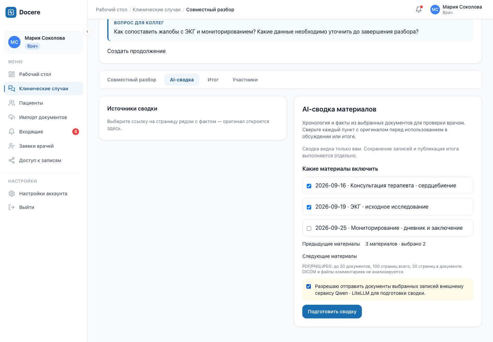

**Путь:** случай → «AI-сводка» → выбрать материалы → разрешить отправку внешнему сервису → «Подготовить сводку».

В этой демонстрации через интерфейс выбраны **две записи из трёх** — консультация и ЭКГ.
Получен настоящий результат внешней модели. Мониторирование в этот запуск не включалось.

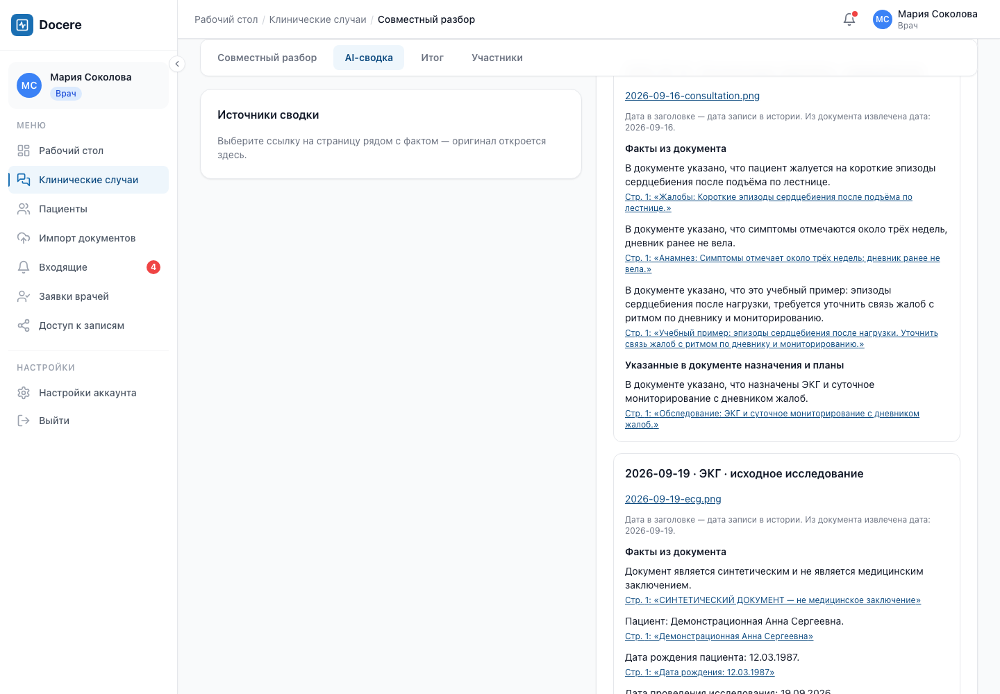

Факты группируются по документам; назначения и планы, упомянутые в исходниках, показаны отдельно.
Сводка личная: другой участник готовит собственный результат. Она не заменяет итог координатора.

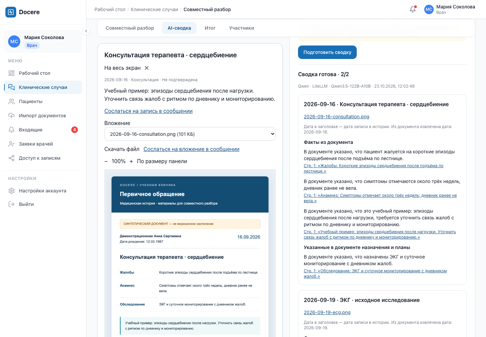

**Попробовать:** нажать ссылку на страницу под фактом и проверить оригинал в соседней панели.

**Фраза:** «AI помогает просмотреть материалы. Врач видит источник каждого утверждения и решает, как использовать его дальше».

## 9. Входящие: конкретная задача вместо потерянного сообщения

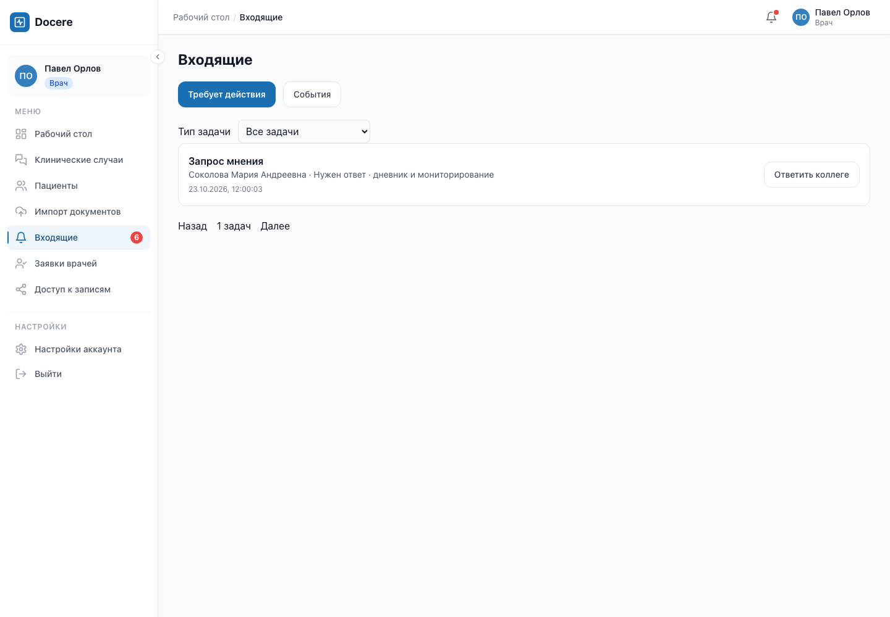

Вкладка **«Требует действия»** собирает приглашения, запросы мнения, независимые доступы
и импорты, ожидающие проверки. Вкладка **«События»** показывает уведомления о произошедших изменениях.
Прочитать уведомление и выполнить задачу — разные действия.

**Попробовать:** войти вторым врачом → «Входящие» → «Ответить коллеге».

## 10. Запросить мнение и получить ответ

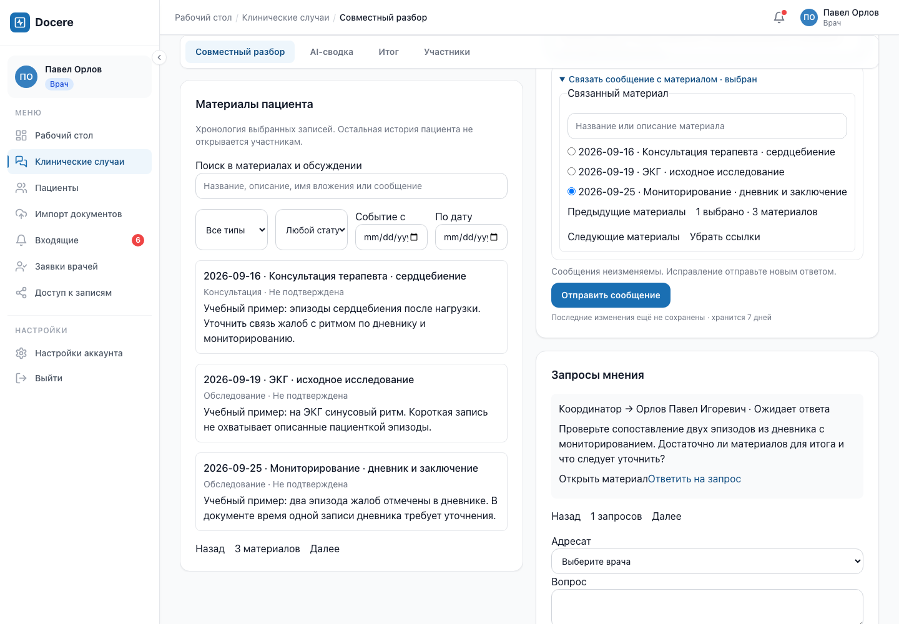

Любой участник может адресовать вопрос другому участнику и сослаться на материал.
Назначенный врач отвечает сообщением; запрос переходит в состояние «отвечен».
Есть обычные сообщения и ответы на них. Личный черновик сохраняется отдельно от отправленного сообщения.

**Что реально сделано для этого гида:** второй врач открыл запрос, отправил ответ;
координатор увидел этот ответ в том же разборе.

**Фраза:** «Ответ остаётся вместе с вопросом и документами, на основании которых он дан».

## 11. Итог: зафиксировать результат обсуждения

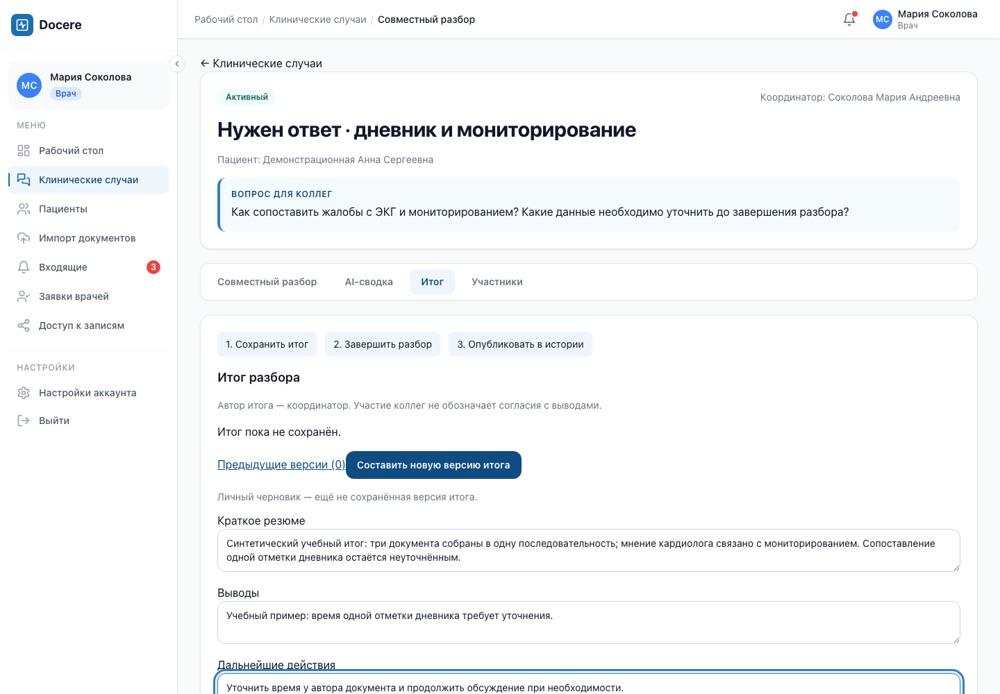

Координатор заполняет три поля: **резюме, выводы, дальнейшие действия** и выбирает источники.
Сохранение создаёт версию итога. Личный черновик ещё не является сохранённой версией.
Предыдущие версии доступны отдельно.

**Важно:** участие врача в обсуждении не означает его автоматического согласия с выводами координатора.

## 12. Завершение: проверить, что остаётся открытым

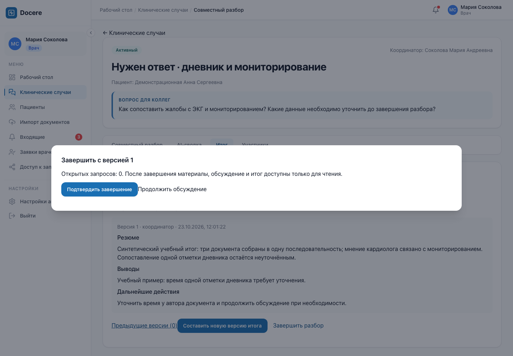

Перед завершением видно, какая версия фиксируется и сколько запросов мнения осталось открыто.
После завершения обсуждение и материалы доступны для чтения.
Несохранённый отличающийся черновик требует отдельного решения; его нельзя незаметно принять за итог.

**Что сделано:** сохранена версия 1, после ответа коллеги открытых запросов не осталось,
завершение подтверждено кнопкой в интерфейсе.

## 13. Публикация: результат появляется в медицинской истории

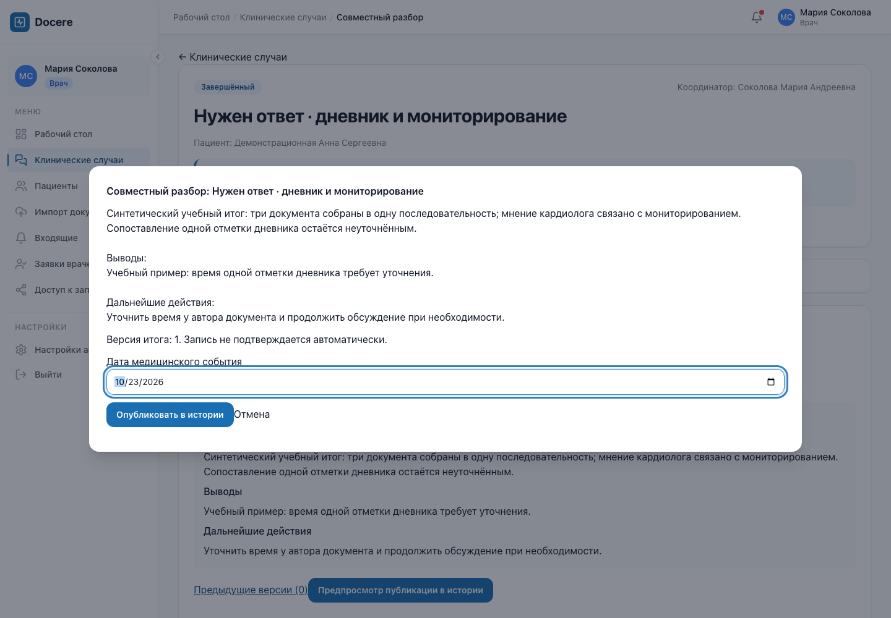

Публикация — отдельный шаг после завершения. Врач видит предпросмотр и указывает дату медицинского события.
Повторный запрос публикации не должен создавать новую копию записи.

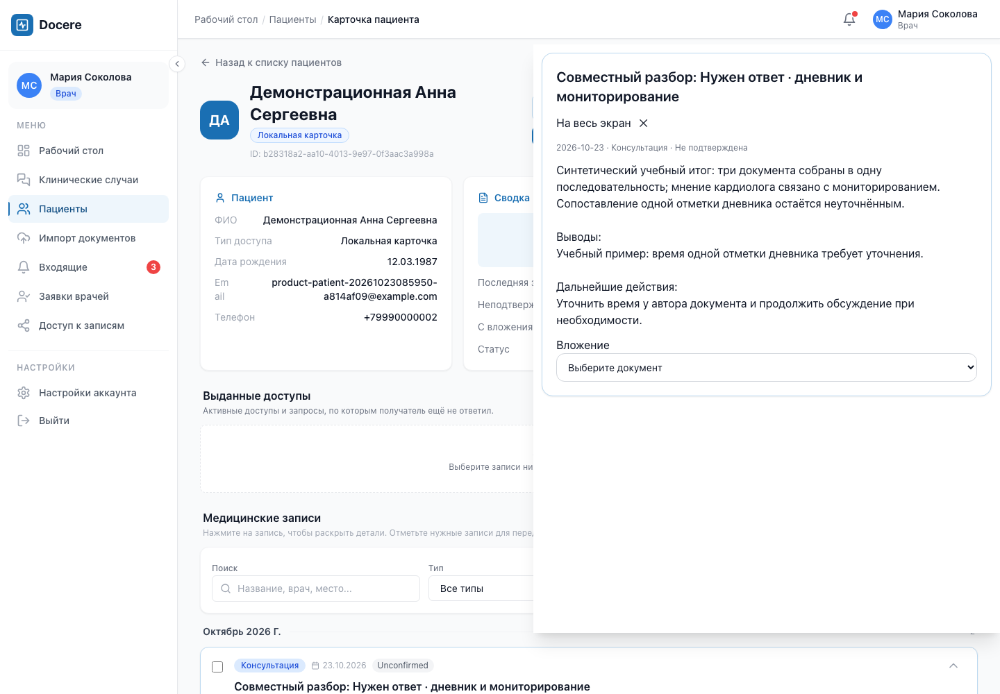

**На скриншоте — результат того же разбора**, в котором в ходе этой экскурсии коллега ответил,
координатор сохранил итог и подтвердил публикацию. Это не подмена заранее готовым другим случаем.

Запись остаётся неподтверждённой до обычной процедуры подтверждения.
Доступ участникам к опубликованной записи автоматически не выдаётся.

**Фраза:** «Обсуждение заканчивается самостоятельной записью в истории, а не остаётся только перепиской».

---

## 14. Передача отдельных записей без совместного разбора

Иногда обсуждение не нужно: достаточно передать документ зарегистрированному пользователю.

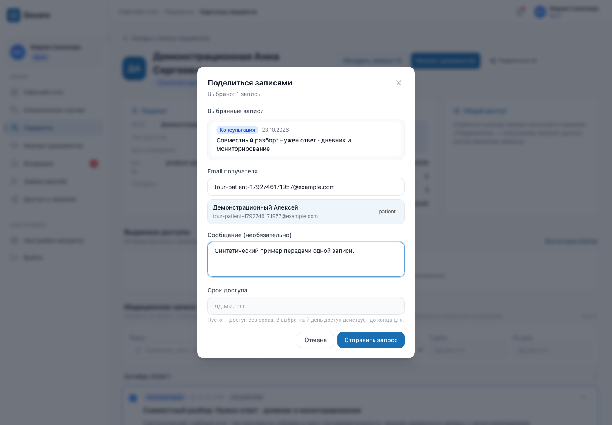

**Путь:** карточка пациента → отметить записи → «Поделиться» → выбрать получателя → отправить запрос.
Можно добавить сообщение и срок доступа.

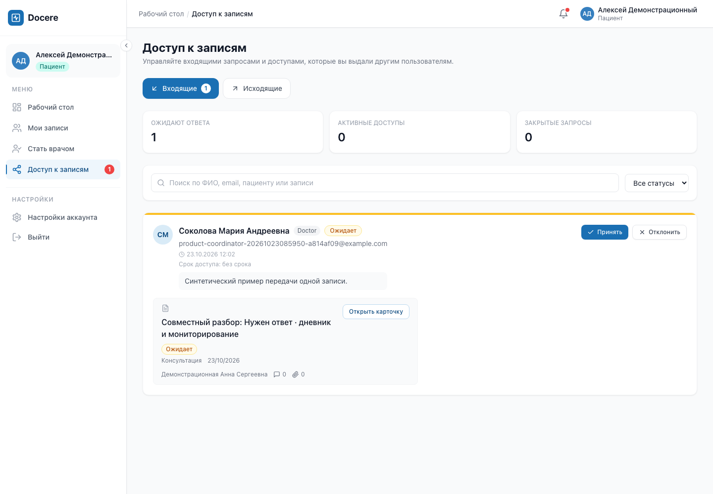

Получатель принимает или отклоняет запрос. Принятие даёт доступ к выбранным записям.

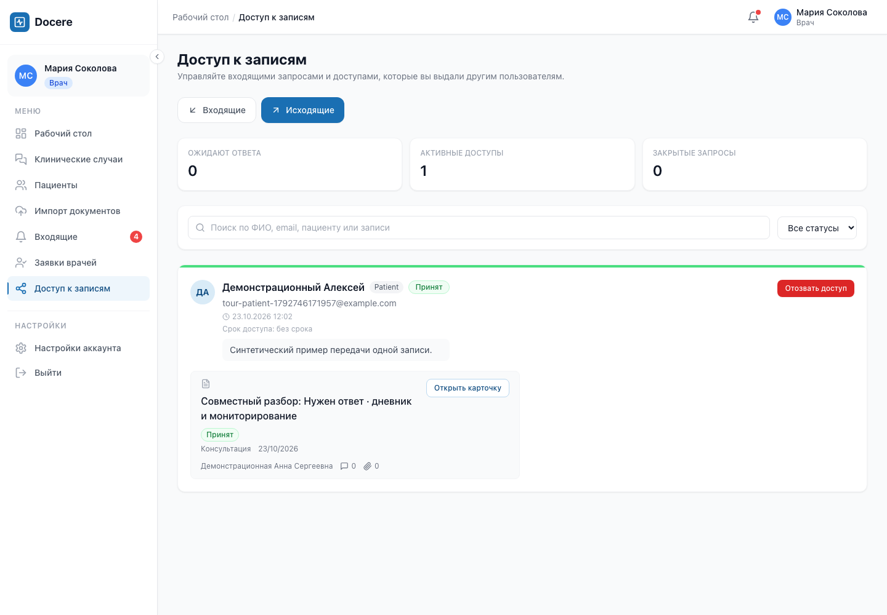

Отправитель видит исходящие запросы и может отозвать доступ. Для последующих передач действует
каскадный отзыв; независимые основания доступа сохраняются.

**В этом проходе:** отправлена одна синтетическая запись новому тестовому пациенту,
он принял её через интерфейс. Отзыв в этом проходе не выполнялся; на скриншоте показано доступное действие.

## 15. Кабинет пациента

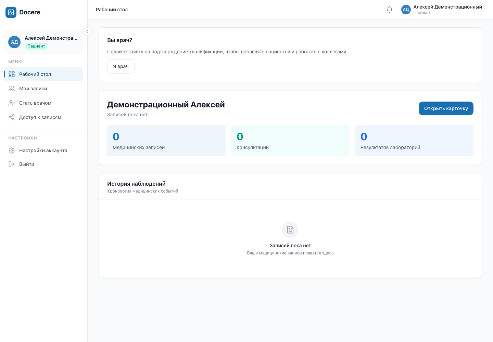

После регистрации пользователь начинает с роли пациента. Доступны собственная карточка,
медицинские записи и управление полученными доступами.

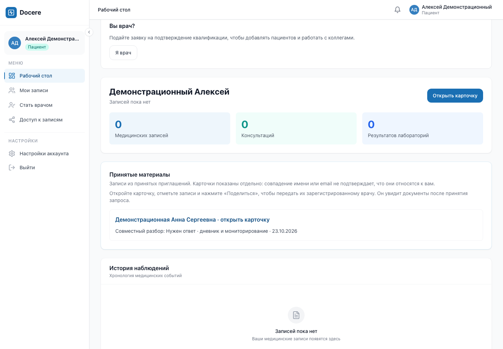

Полученные записи показываются в блоке **«Принятые материалы»** отдельно от собственной истории.
Нельзя автоматически считать чужую карточку своей только из-за совпадения имени.
Принятые записи можно открыть и передать врачу через тот же механизм доступа.

## 16. Регистрация и получение роли врача

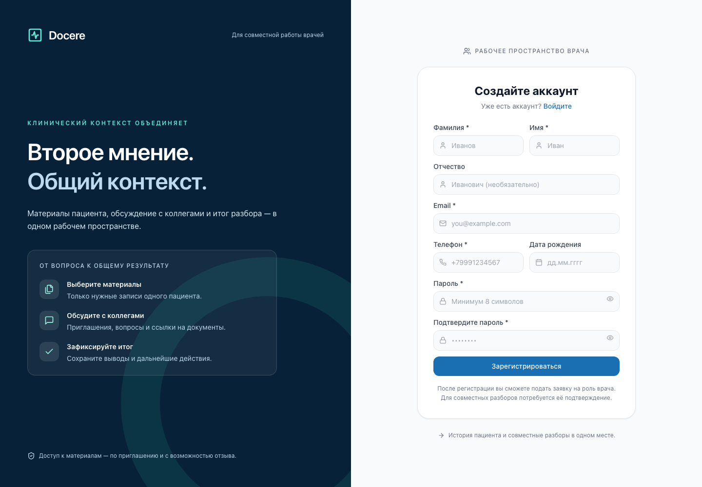

Регистрация собирает данные аккаунта. В этой экскурсии новый тестовый пациент действительно
зарегистрирован через эту форму.

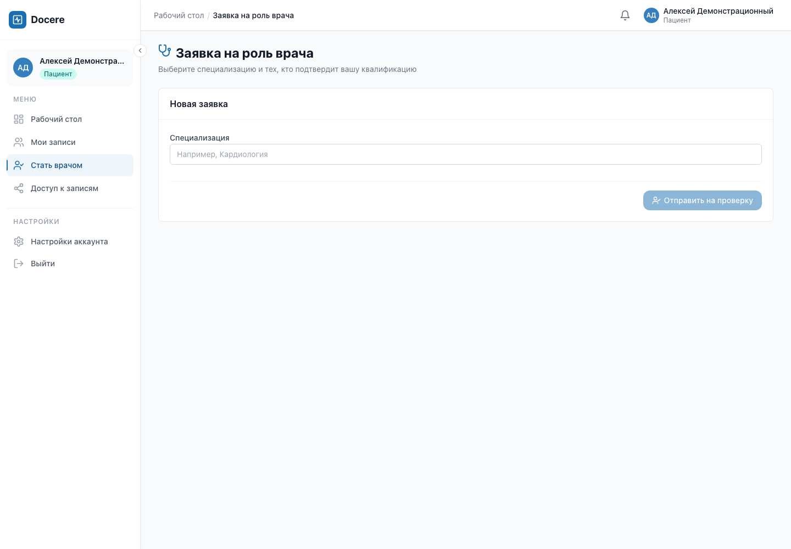

Если пользователь — врач, он подаёт заявку и указывает специализацию.
Роль подтверждается администратором либо двумя подтверждёнными врачами той же специализации.
Простое изменение профиля не выдаёт роль врача.

На этом проходе открыта форма заявки; новая заявка не отправлялась.

## 17. Профиль и настройки

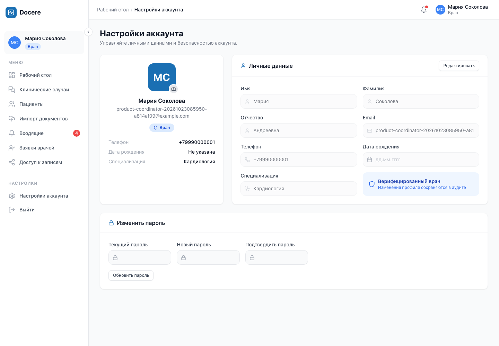

Здесь редактируются доступные поля профиля и меняется пароль.
Изменение профессиональных данных подтверждённого врача фиксируется в аудите.
В этой экскурсии настройки открыты для просмотра; пароль и профиль не изменялись.

## 18. Администратор: пользователи и журнал действий

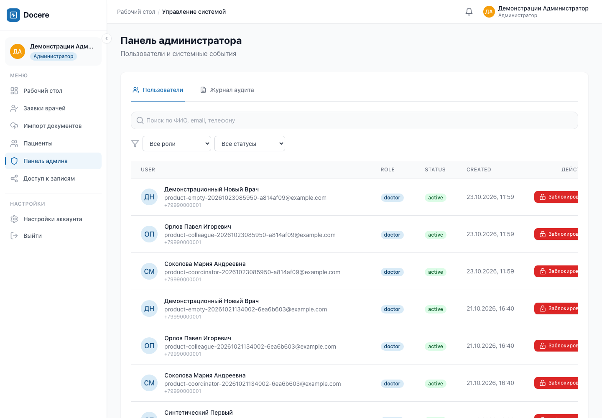

У администратора отдельный интерфейс: список пользователей, поиск и управление состоянием аккаунтов.
Проверка заявок врачей доступна отдельным разделом.

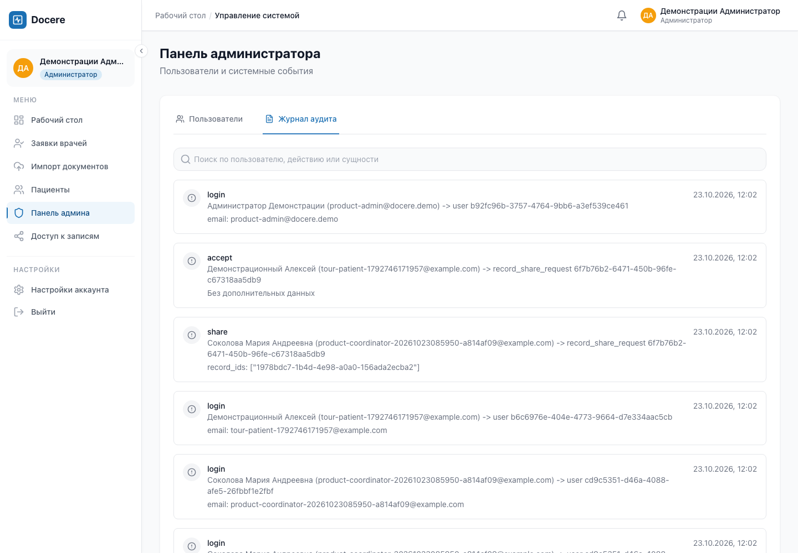

Журнал позволяет просмотреть значимые события системы: операции с записями, доступами и аккаунтами.
Это служебная возможность; для короткой продуктовой презентации достаточно одного кадра.
В проходе просмотрены пользователи и аудит; блокировки и изменение ролей не выполнялись.

---

## Ссылки для самостоятельного теста

**Приложение:** [localhost:8012](http://localhost:8012).
Аккаунты и пароль прежние — [локальная памятка стенда](../artifacts/product-demo/20261021134002-6ea6b603/OPEN-ME.md).
Для двух врачей используйте обычное окно и инкогнито или разные профили.

| Что открыть | Ссылка для текущего локального стенда |
|---|---|
| Рабочий стол | [Открыть](http://localhost:8012/dashboard/doctor) |
| AI-предложения и оригинал консультации | [Проверка импорта](http://localhost:8012/upload/review/f08aeaa2-87ff-4671-93d3-b4330b79f41b) |
| История тестового пациента | [Открыть](http://localhost:8012/patients/3d659a3b-bea8-47ed-b722-2a72f47079e6) |
| Разбор, оставленный для самостоятельного ответа | [Открыть](http://localhost:8012/cases/07245c03-161c-4ee7-9d03-e9adae83fae3) |
| Импорт новых документов | [Открыть](http://localhost:8012/upload) |

Для скриншотов совместного сценария создан **отдельный набор** `20261023085950-a814af09`.
Его активный разбор уже завершён и опубликован во время прохода; исходный пользовательский набор не использовался для этих действий.
Ссылки выше относятся к исходному набору, оставленному для самостоятельного теста.
Памятка с аккаунтами — локальный артефакт, в Git её нет; скриншоты и этот гид сохраняются в репозитории.

## Что показано, а что не проверялось в этой экскурсии

**Выполнено через UI:** вход двух врачей, просмотр истории и PNG, переход к источнику AI-импорта,
выбор двух материалов и реальная AI-сводка, ответ на запрос, сохранение итога,
завершение, публикация и открытие созданной записи, регистрация пациента,
отправка и принятие независимого доступа. Просмотрены формы создания случая и записи,
профиль, заявка врача, список пользователей и аудит.

**Подготовлено заранее через API:** исходные записи, импорт на проверке, случаи, приглашения и запрос мнения.
AI-импорт консультации выполнен в предыдущей проверке; в этом проходе показаны его сохранённые предложения и источник.
Это не заявление о прохождении полного регрессионного тестирования.

**Есть в системе, но не демонстрировалось отдельным прогоном здесь:** импорт DICOM/ZIP,
просмотр PDF, отмена и отзыв прав, подтверждение медицинской записи, рассмотрение заявки врача,
ошибки сети, мобильные размеры. DICOM-viewer не входит в продукт: импорт DICOM не означает просмотр исследований как на диагностической станции.

**Не заявляем как готовую функцию:** постановку диагноза AI, автоматическое назначение лечения,
автоматическое объединение пациентов, интеграцию с внешними МИС, видеоконсультации.
Экономия времени и востребованность у реальных врачей требуют пользовательской проверки.

## Почему сейчас может быть запутанно — наблюдения после прохода

1. **Два вида AI.** Извлечение при импорте и сводка в случае решают разные задачи; в первом знакомстве это нужно объяснить явно.
2. **Три состояния результата.** Черновик, версия итога и опубликованная запись находятся рядом, но означают разные вещи.
3. **Два способа передачи.** Приглашение в случай и независимый доступ к записи похожи внешне; выбор зависит от того, нужно ли обсуждение.
4. **Длинная проверка импорта.** Форма и AI-предложения занимают много места; источник рядом помогает, но нужно прокручивать страницу.
5. **Оформление ещё неоднородно.** В деталях записи встречаются английские обозначения статуса; отдельные счётчики и подписи требуют упрощения.

Этот гид объясняет текущий интерфейс. Следующий продуктовый шаг — упростить именно эти места,
чтобы пользователю не требовалась экскурсия для первого успешного разбора.
