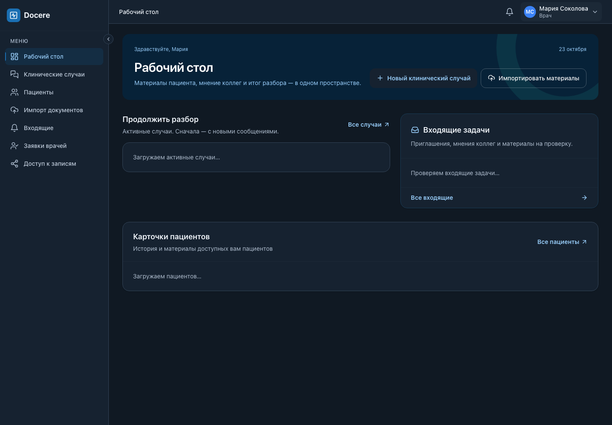
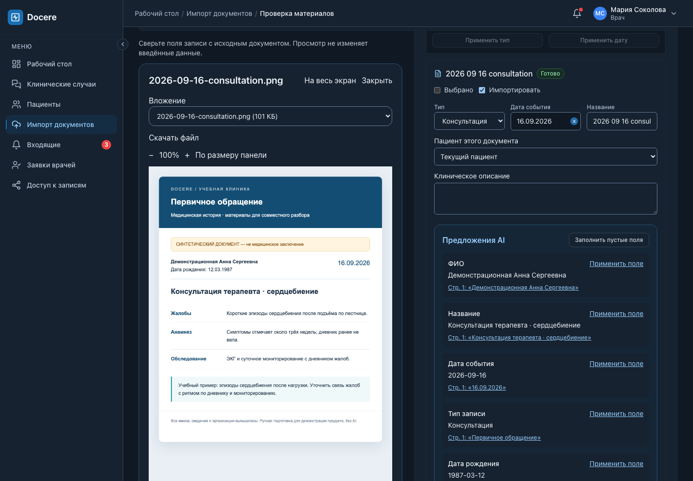

# Docere: сделать основной сценарий понятным

Дата: 23 октября 2026. Область: интерфейс врача, импорт, история пациента и совместный разбор.

Это экспертный аудит интерфейса и план изменений, а не результат исследования врачей.
Проверены код, реальные экраны локального стенда и [экскурсия по продукту](PRODUCT-TOUR.md).
Новые медицинские данные внешнему AI для этого аудита не отправлялись.

## 1. Что сейчас мешает

Основные возможности уже есть. Проблема — в количестве одновременно предложенных решений
и в том, что устройство системы слишком заметно пользователю.

| Наблюдение | Последствие | Решение |
|---|---|---|
| Имя, роль, настройки и выход повторялись в боковом меню и шапке | Две точки управления одним аккаунтом; меню занимает лишнее место | Один профиль справа сверху; слева только разделы |
| «Оригинал рядом» — заголовок экскурсии, но не понятное действие интерфейса | Неясно, что откроется, где и как вернуться | «Открыть документ», имя файла, видимая панель и возврат к полям |
| В проверке импорта сначала несколько сводок и блок AI, затем длинные формы всех документов | Врач ещё не видит документ, но уже выбирает множество параметров | Проверка одного документа в рабочей области; остальные в списке |
| «Готово: 3» одновременно с «Требуют решения: 1» без единиц | Можно принять заполненность полей за завершение импорта | Раздельные показатели документов и вопросов о пациенте |
| В форме два флажка «Выбрано» и «Импортировать», отдельно выбор файлов для AI | Неясно, какая операция использует какой выбор | Разделить включение в импорт и временный выбор для группового действия |
| AI-предложения повторяют всю форму и вытесняют оригинал | Трудно сравнить текущее значение, предложение и источник | Предложение рядом с конкретным полем; источник открывается по ссылке |
| Материалы, фильтры, чат и запросы мнения одновременно развёрнуты | На вопрос коллеги приходится искать форму ответа ниже | Открывать адресованный запрос и форму ответа в контексте перехода |
| Даты в интерфейсе представлены как ISO, русская дата и браузерный формат | Ненужное переключение внимания | Общие форматтеры отображения; единый ввод дат |
| Импорт использует имя `documents.zip` даже при загрузке отдельных документов | Техническая упаковка выглядит как пользовательский объект | «3 документа · 21 октября», исходные имена в деталях |

Не следует решать все эти проблемы сокращением пояснений: сведения о передаче данных AI,
доступе коллег, публикации и подтверждении медицинской записи должны оставаться видимыми там,
где врач принимает соответствующее решение.

## 2. На какие рекомендации опираемся

1. **Узнавание вместо запоминания:** выбранный документ, пациент и действие должны быть видны
   в текущем контексте. Это основание для рабочей области «документ + поля», а не требования
   запомнить содержимое другого экрана. [NN/g: Recognition and Recall](https://www.nngroup.com/articles/recognition-and-recall/).
2. **Постепенное раскрытие:** редкие массовые операции, версии AI и технические сведения
   доступны в деталях; текущая задача остаётся на первом плане.
   [NN/g: Progressive Disclosure](https://www.nngroup.com/articles/progressive-disclosure/).
3. **Видимое состояние:** отличать «сохранён черновик», «документ проверен», «запись создана»
   и «запись подтверждена». После действия показывать результат и следующий шаг.
   [NN/g: Visibility of System Status](https://www.nngroup.com/articles/visibility-system-status/).
4. **Цвет по назначению:** фон страницы, поверхность карточки, текст, границы и статусы
   должны иметь согласованные пары для обеих тем. Исходники документов не перекрашивать.
   [Material Design: Color roles](https://m3.material.io/styles/color/the-color-system).
5. **Читаемость:** целевой контраст обычного текста ≥4.5:1, крупного ≥3:1; значимые
   границы контролов и индикаторы ≥3:1. Цвет не заменяет подпись состояния.
   [W3C: Text contrast](https://www.w3.org/WAI/WCAG22/Understanding/contrast-minimum.html),
   [W3C: Non-text contrast](https://www.w3.org/WAI/WCAG22/Understanding/non-text-contrast.html).

Конкретные изменения ниже — применение этих принципов к Docere, а не вывод, что любой
медицинский продукт должен иметь именно такую структуру.

## 3. Первый пакет: небольшие изменения

Реализуется вместе с этим планом:

- Единственный профиль в шапке; настройки и выход доступны оттуда, включая мобильный экран.
- Светлая, тёмная и системная темы с сохранением выбора в браузере.
- Понятное открытие исходника импорта, обозначение выбранного документа и возврат к форме.
- Уточнение формулировки «Оригинал рядом» в экскурсии.

Приёмка: отсутствие дубликата аккаунта в навигации; меню работает клавиатурой;
тема сохраняется после перезагрузки и следует ОС только в системном режиме;
оригинал сохраняет свои цвета; открытие/закрытие просмотра не сбрасывает введённые поля.

### Реальные экраны первого пакета

[Меню аккаунта на телефоне](screenshots/ux/account-mobile-dark.png).

Проверены TypeScript, production build, lint и все 101 frontend-тест.
В браузере проверены ширины 390/768/1440, выбор и сохранение темы, реакция на тему ОС,
открытие исходника и возврат фокуса к форме. Это не полный аудит соответствия WCAG:
все экраны, все состояния ошибок и 200% масштаб в этом небольшом пакете не проверены.

## 4. Следующий пакет: проверка документов — главный приоритет

### UX-01. Рабочая область одного документа

**Результат:** врач последовательно проверяет документы, не прокручивая формы всего импорта.

- Верхняя область: «Проверка документов», общий прогресс и сохранение черновика.
- Компактный список документов: имя, пациент, состояние «Нужны данные / Можно сохранить / Пропущен».
- Выбранный документ: оригинал слева, его поля справа. На узком экране — переключение
  «Документ / Поля записи» с видимым именем выбранного файла.
- Привязка к пациенту остаётся явным решением; при конфликте выделяется обязательный вопрос.
- Перенос к другому пациенту — действие конкретного документа. Не объединять карты по ФИО.
- Основное действие текущего документа: «Следующий документ». Итоговое действие:
  «Сохранить N записей в историю» с проверкой нерешённых вопросов и кратким подтверждением.
- Массовые действия спрятать под «Действия с несколькими документами»; выбор для них
  не означает включение или исключение из импорта.
- При смене документа, возврате назад и конфликте версии сохранять существующий механизм
  черновика; не перезаписывать локальные правки обновлёнными AI-результатами.

**Точки изменения:** `UploadReviewPage`, `RecordGroupReviewCard`, существующий viewer и review hooks.
Сначала выделить компоненты списка, редактора документа и итоговой панели; API и права не переписывать.

**Приёмка:** импорт трёх файлов, разных пациентов, пропущенного файла и отсутствующей даты;
прямой переход к источнику AI; возврат к прежнему полю; перезагрузка; конфликт двух вкладок;
390/768/1440 px. Состояния «проверен» и «подтверждён врачом» не смешивать.

### UX-02. AI как помощь конкретному действию

- В импорте: «Заполнить поля по документу». В случае: «Составить сводку материалов».
  Сохранить уточнение AI и видимое согласие на внешнюю обработку.
- В редакторе поля показывать текущее значение и отдельное предложение, источник и «Применить».
  Замена непустого значения требует явного действия; массовое заполнение — только пустых полей.
- Модель, версия запуска и история обработки раскрываются в «Сведения об анализе».
- После анализа: «Предложения готовы — проверьте по документу». Не использовать «Готово»
  как синоним завершённой врачебной проверки.
- Прогресс считает завершённые документы отдельно от выполняющихся и ошибок.

**Приёмка:** отличие двух AI-сценариев понятно по названию действия; новая версия не стирает
правки; можно найти источник каждого предложения; ошибки и частичный результат не скрыты.

## 5. После импорта: совместная работа

### UX-03. Один следующий шаг в клиническом случае

- Сохранить разделы разбора, AI-сводки, итога и участников.
- Из входящей задачи открывать сам запрос мнения с вопросом, источником и формой ответа,
  а не верх длинной страницы. Существующие адресные API и ссылки переиспользовать.
- Разделить «Ответить на запрос» и «Написать сообщение»: сейчас они слишком похожи,
  хотя только первый закрывает адресованную задачу.
- Фильтры материалов свернуть под «Фильтры» с количеством применённых; простой поиск оставить.
- Статус случая должен сопровождаться смыслом: кто ждёт ответа / есть ли сохранённый итог /
  опубликован ли результат. Не объявлять всех участников согласными с итогом.
- В «Итоге» сохранить последовательность «Сохранить → Завершить → Опубликовать»,
  показывая одно основное следующее действие. Версии и журнал — отдельные раскрываемые блоки.
- Не скрывать несохранённый текст ради упрощения экрана; сохранить защиту черновика при завершении.

**Точки изменения:** `CasePage`, `CaseDiscussion`, `CaseConclusion`, existing inbox targets.
**Приёмка:** второй врач без подсказок находит запрос, открывает источник и отвечает;
координатор видит результат, завершает и публикует; закрытый случай остаётся read-only.

### UX-04. Навигация и карточка пациента

- Основные разделы врача: рабочий стол, пациенты, случаи, входящие, импорт.
- «Доступ к записям» сохранить как управление независимой передачей; не смешивать его
  с приглашением в совместный разбор. Названия и пояснения должны объяснять разницу.
- Заявки врачей отнести к вспомогательным действиям, сохранив индикатор ожидающих заявок
  и доступность тем ролям, которые могут рассматривать их сейчас.
- В пациенте сначала идентичность, хронология и действия «Добавить документы / Создать разбор».
  Детали происхождения, технические свойства и история доступа раскрывать по запросу.
- Отдельные публичные статусы: «Не подтверждена», «Подтверждена врачом», «Получена от коллеги».
  Наличие записи в истории не означает её подтверждение.

**Приёмка:** врач находит пациента, добавляет документ, создаёт случай из выбранных записей;
пациент видит собственные и принятые материалы без смешения карт; прежние прямые ссылки работают.

## 6. Общая полировка и визуальная система

### UX-05. Общие правила для изменяемых экранов

- Один заполненный основной CTA на текущую задачу; вторичные — outline/text.
- Одинаковые названия: «документ» = исходный файл, «запись» = событие истории,
  «материалы случая» = выбранные записи, «итог» = вывод координатора,
  «AI-сводка» = личный вспомогательный результат.
- Общие компоненты только для повторяющегося поведения: статусы, пустые состояния,
  ошибки с повтором, форматирование дат/количества, панели действий.
- Убрать английские внутренние статусы, UUID и названия внутренних ZIP из основных карточек.
  Не удалять технические идентификаторы из диагностических деталей, где они нужны.
- Различать фон, поверхность, выбранный элемент и hover в обеих темах; медицинские изображения
  сохранять без фильтров. Не решать тёмную тему CSS-инверсией всего приложения.
- Проверить tab order, видимый focus, Escape и возврат фокуса; обычную встроенную панель
  не выдавать за модальный диалог. Настоящий modal должен удерживать фокус.

## 7. Как проверить, стало ли удобнее

Начать с пяти врачей для качественного поиска проблем, а не статистического доказательства
спроса. Это отправная точка, не магическое достаточное число для всех исследований.
[NN/g: How Many Test Users](https://www.nngroup.com/articles/how-many-test-users/).

Дать синтетические документы и задачи без подсказок о кнопках:

1. Найти пациента и добавить консультацию, сверив дату с оригиналом.
2. Исправить ошибочное AI-предложение и сохранить запись.
3. Пригласить коллегу для разбора двух материалов.
4. Под вторым аккаунтом ответить на запрос с опорой на документ.
5. Сохранить итог и опубликовать его с правильной датой.

Наблюдать: завершение без помощи, ошибочные переходы, возвраты, потеря текста,
понимание различий «сводка / итог / запись», «доступ / приглашение», время и субъективную трудность.
Сначала записать исходный результат, затем повторить с новым интерфейсом и сопоставимой задачей.
Цель итерации: все критические задачи выполняются без подсказки и потери данных;
не трактовать результат пяти сессий как количественное доказательство роста конверсии.

Проверка спроса — отдельные вопросы после задания: как врач решает это сейчас, когда это было
в последний раз, готов ли повторить реальный рабочий сценарий в пилоте и кто принимает решение
об использовании. Красивый стенд сам по себе востребованность не доказывает.

## 8. Порядок реализации и разделение между агентами

1. Текущий небольшой пакет и тёмная тема → визуальная проверка → локальный commit.
2. UX-01: сначала макет рабочей области на синтетических данных, затем интеграция с текущими hooks.
3. UX-02 поверх UX-01; не поручать двум агентам одновременно менять review-страницу.
4. UX-03 можно делать параллельно с UX-01 в отдельных case-компонентах.
5. UX-04 и UX-05 после проверки основных сценариев, затем короткие сессии с врачами.

Для каждой задачи: заранее закрепить файлы владельца, сохранить API/access invariants,
не менять общий CSS несколькими агентами одновременно. Интегратор проверяет стыки и сценарий.
Не начинать с новой библиотеки компонентов, переписывания всех экранов или нового AI-функционала.

Обязательная техническая проверка каждого пакета: scoped frontend tests, TypeScript, lint/build,
браузерные сценарии на синтетических данных в двух темах; desktop/mobile и 200% увеличение.
Отдельно проверять отказ доступа, истёкшую сессию, ошибку сети и сохранение черновика.
Документация и локальный commit после каждого принятого пакета; push только по запросу.
