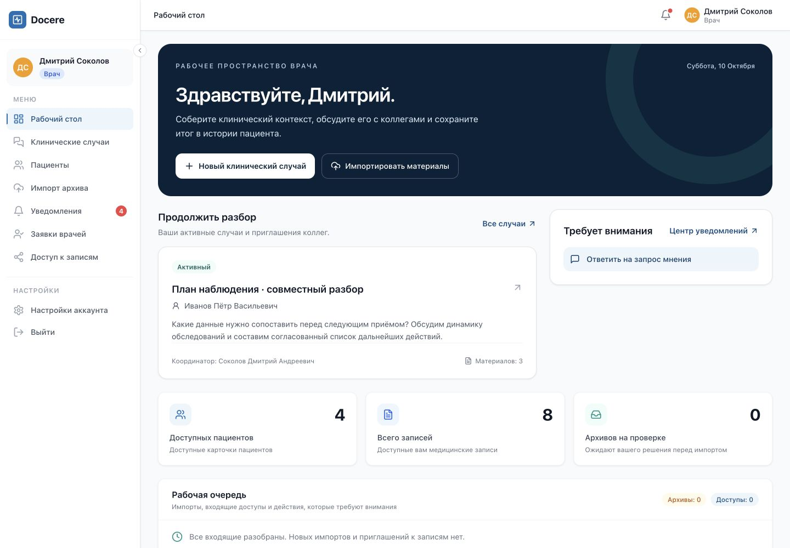
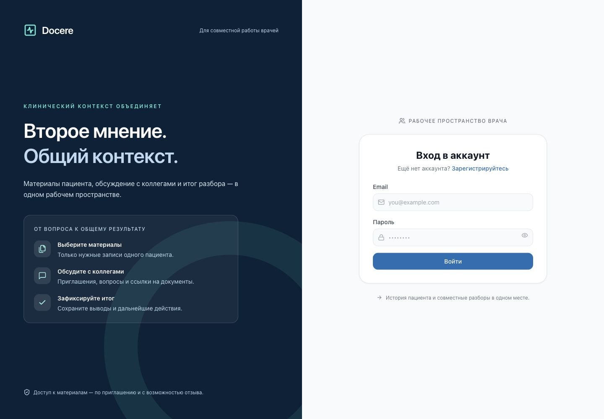

# Docere: пользовательское ревью и следующий этап

Ревью начато 7 октября, завершено 10 октября 2026 года. База — `master` на `1985d09`;
изменения — в `feat/doctor-workspace-polish`.

## Оценка продукта

У Docere уже есть убедительный сценарий: врач собирает документы, приглашает коллегу,
получает мнение и сохраняет итог. Управляемый доступ и связь обсуждения с материалами
отличают его от переписки в мессенджере. До правок интерфейс слабо показывал эту ценность:
главная страница была похожа на административную панель со статистикой,
а самый важный раздел выглядел как набор технических форм.

Дизайн теперь лучше поддерживает этот сценарий, но одной визуальной полировки недостаточно
для вывода о готовности к продажам. Следующая проверка — дать 3–5 врачам самостоятельно
пройти разбор и зафиксировать затруднения. Это экспертное ревью интерфейса и кода,
а не результат исследования с реальными врачами или подтверждение клинической эффективности.

## Исправлено сразу

| Наблюдение | Изменение |
|---|---|
| Рабочий стол начинался с пустого блока; совместный разбор не был главным действием | Новый вводный блок с созданием случая и импортом; активные случаи и задачи рядом; компактная статистика |
| «Среднее записей» занимало место без ясного действия | Вместо него — число архивов на проверке; при загрузке/ошибке показывается прочерк, а не ложный ноль |
| Список случаев выглядел как необработанная выдача API | Карточки со статусом, пациентом, вопросом, координатором, материалами и непрочитанными сообщениями; фильтры и понятное пустое состояние |
| На медленном запросе сразу появлялось «случаев нет» | Отдельные состояния загрузки, отсутствия данных и ошибки с повтором; защита от устаревших ответов сохранена |
| В меню смешивались Dashboard, Sharing и русский; в пути страницы показывались UUID | Русские названия и нейтральные подписи маршрутов; случаи и пациенты подняты выше в меню |
| Колокольчик мог говорить «нет новых», хотя в случаях были уведомления | Учитывается счётчик клинических уведомлений, добавлен переход в их центр |
| На телефоне меню оставалось поверх выбранной страницы | Закрытие после перехода; Escape закрывает меню/всплывающие панели; кнопкам добавлены доступные имена |
| Разбор — длинная страница, после «Ответить» поле находилось выше экрана | Быстрые переходы к разделам; фокус в поле ответа; вопрос для коллег выделен; статусы участников и материалов переведены |
| На входе были неработающие «Запомнить меня» и «Забыли пароль?» | Убраны ложные элементы; показ пароля доступен с клавиатуры; ошибка ограничения входов объяснена по-русски |
| Регистрация ссылалась на несуществующие правила и политику через `#` | Убраны фиктивные ссылки, объяснён реальный путь получения роли врача. Настоящие документы остаются отдельной задачей перед публичным запуском |
| Экран входа обещал «новое поколение записей», но не объяснял сценарий | Конкретное позиционирование и три шага: материалы → обсуждение → итог |
| Шрифты дважды загружались с Google Fonts | Системный стек шрифтов, без внешней загрузки; русский язык HTML; reduced motion и видимый фокус |
| При замене frontend-сборки открытая вкладка могла потерять старый JS-чанк и стать белой | Error boundary с явным обновлением страницы и предупреждением о несохранённом тексте. Сохранение старых assets при deploy — отдельное улучшение |

API доступа, sharing, публикация и серверные медицинские правила не менялись.
Новые карточки получают разрешённое сервером представление; до принятия приглашения
не показывают пациента, вопрос и обсуждение.

## Как выглядит результат

Все данные на снимках синтетические. Каталог назван по дате начала ревью;
финальные снимки рабочего стола и входа сделаны 10 октября.

[Рабочий стол до изменений](assets/2026-10-07/dashboard-before.jpg)

[Список случаев](assets/2026-10-07/cases-after.jpg) · [Мобильный список](assets/2026-10-07/cases-mobile.jpg)

## Следующие изменения: тезисы для планирования

Приоритеты идут сверху вниз. M — самостоятельная функция с несколькими состояниями;
L — затрагивает API, данные и несколько экранов. Это оценка объёма, не срок исполнения.

| Приоритет | Изменение | Как работает и как принять | Объём |
|---|---|---|---|
| 1 | Рабочее пространство разбора | На широком экране материалы и документ слева, обсуждение справа; итог и участники в отдельных разделах. Не сбрасывать текст при переключении. На телефоне последовательные экраны с сохранением позиции. Врач читает документ и отвечает без поиска поля по длинной странице | L |
| 1 | Создание случая за три шага | Пациент с ФИО и датой рождения → выбранные материалы → вопрос и приглашение. Сейчас видны «паспорт» и UUID, мало подсказок. Показывать количество выбранного, объяснять пустую историю и черновик; доступ не выдавать до принятия приглашения | M |
| 1 | Единые входящие | Случаи, запросы мнения, доступы и импорт в одной очереди с понятным следующим действием. Сейчас клинические и остальные уведомления имеют разные модели. Прочтение отдельно от выполнения; ясные дата, автор и доступный контекст; серверная пагинация | L |
| 1 | Сохранность незавершённой работы | Предупреждать об уходе с несохранённым текстом, предусмотреть серверные черновики с ACL и сроком хранения. Не складывать клинический текст в localStorage. Обновление релиза не должно стирать введённый текст; старые assets сохранять на переходный период | L |
| 2 | Единый просмотр документов | Одинаковый viewer из истории и случая, название/дата/автор, переключение вложений, увеличение и ссылка на источник. Сейчас история и случай используют разные способы работы с документом. Проверять доступ на каждом открытии | M |
| 2 | Завершение и публикация | Видимый путь «итог → завершить → опубликовать», предпросмотр, дата события, понятное подтверждение успеха. История версий свёрнута по умолчанию; названия источников вместо обрезанных UUID | M |
| 2 | Первый вход врача | После регистрации объяснить статус заявки и следующий шаг. Добавить короткий вводный сценарий с синтетическими данными в отдельном demo-окружении; у нового пользователя должен быть очевидный старт | M |
| 2 | Единые компоненты и доступность | Привести диалоги, формы, пустые состояния и действия к общей системе. Удержание/возврат фокуса в модальных окнах, проверка контраста, увеличение до 200%, длинные имена, узкие экраны. Быстрые исправления не являются полным WCAG-аудитом | M |
| 3 | Поиск и масштаб | Серверный поиск и пагинация пациентов/истории, фильтры в URL и восстановление при возврате. Сейчас часть списков и счётчиков опирается на загрузку массива целиком | L |
| Перед публичным запуском | Восстановление доступа и документы продукта | Настоящий сброс пароля с ограничениями частоты, оформленные правила/политика, понятный канал поддержки. Не возвращать фиктивные ссылки или обещания безопасности | L |

Отдельный дефект, найденный повторными E2E-прогонами: при выборе другой даты или изменении
материалов после анализа архива сервер может найти дубль, которого нет в исходном отчёте.
Ответ `422 duplicate_confirmation_required` содержит `group_id`, но форма показывает только
общую ошибку и не добавляет возможность подтвердить именно эту группу. Повторное нажатие
не решает проблему. Требуется показать проблемную группу, дать проверить историю и явно
подтвердить дубль либо пропустить запись; обработать отклонённый Promise отправки.
Критерий проверки: загрузить архив повторно, выбрать альтернативную дату уже существующей записи,
получить предупреждение и завершить импорт через интерфейс. Это отдельное изменение workflow
импорта; в текущую полировку оно не включено.

Рекомендуемый ближайший пакет: исправление этого сценария импорта, рабочее пространство разбора,
создание случая и сохранность текста.
Эти изменения напрямую сокращают число действий врача и дадут больше эффекта на демонстрации.

## AI: первая полезная функция

**Предлагаемая первая версия — «Подготовить сводку материалов».** Врач отмечает записи
в случае, видит состав источников и запускает подготовку. Получает краткую хронологию,
факты из выбранных документов и перечень явно отсутствующих сведений. Каждый фактический пункт
связан с записью, вложением и, когда доступно, страницей/фрагментом. Клик открывает источник.
Это предложение для следующего этапа: AI в текущие изменения не включён.

Сначала использовать структурированные описания записей и уже существующий текст.
PDF с текстовым слоем подключить после реализации извлечения с привязкой к страницам.
Для сканов понадобится отдельный OCR workflow с качеством распознавания и проверкой врачом;
нельзя молча считать непрочитанный файл обработанным. На экране всегда перечислять включённые
и пропущенные материалы.

Затем добавить **«Черновик итога обсуждения»**: отделить мнения участников, открытые вопросы
и предложенные дальнейшие действия. Врач редактирует результат и отдельным действием сохраняет
версию итога. Генерация не должна сама закрывать случай, публиковать запись, подтверждать её
или обозначать согласие всех участников. Не включать постановку диагнозов и назначения в этот MVP.

Технические условия для следующего агента:

- Оставить FastAPI, PostgreSQL, Celery/Redis; AI-провайдер — за application port.
  Долгую генерацию выполнять фоновым заданием с повтором, отменой и понятным статусом.
- Авторизация по существующим case-use-cases до формирования контекста, перед выдачей результата
  и при открытии источников. При потере любого требуемого доступа скрывать производную сводку,
  включая кэш и SSE. Не разрешать модели самостоятельно выбирать пациента или расширять выборку.
- Сохранять provenance: инициатор, набор и версии/хэши источников, время, версия шаблона и модели.
  Изменение источника делает сводку устаревшей. Отличать AI-черновик от сохранённого врачом итога.
- Текст документов считать недоверенными данными, не инструкциями для модели.
  Модель не получает права на изменение данных, сетевые инструменты и токены приложения.
  Проверять формат результата и принадлежность каждой ссылки разрешённому набору.
- Решить отдельно способ размещения модели и допустимость передачи данных провайдеру.
  До этого проверять на синтетических материалах. Поставщик, стоимость и лимиты здесь не выбраны.
- Проверять на наборе сценариев: отсутствующий факт, противоречащие записи, нечитаемый файл,
  инструкция внутри документа, отзыв доступа во время генерации, повтор задания и устаревший источник.
  Измерять корректность ссылок, неподтверждённые утверждения, время ответа и полезность для врача.

Ограничение полномочий модели и проверка источников нужны, потому что RAG сам по себе не исключает
инструкции, внедрённые в документы: [OWASP Prompt Injection](https://genai.owasp.org/llmrisk/llm01-prompt-injection/).
Видимый клавиатурный фокус проверяется отдельно от оформления:
[W3C Focus Visible](https://www.w3.org/WAI/WCAG22/Understanding/focus-visible.html).

## Демонстрация на защите: 4–5 минут

1. Рабочий стол: показать одну реальную задачу и перейти в случай.
2. Открыть материал и вопрос коллеги; объяснить, что участники видят только выбранные записи.
3. Во втором аккаунте ответить со ссылкой на документ, в первом увидеть обновление.
4. Сохранить итог, завершить разбор и явно опубликовать запись с датой события.
5. Отозвать участие и показать закрытие доступа к обсуждению/вложению.

Использовать отдельные профили браузера для двух врачей и заранее подготовленные синтетические данные.
AI демонстрировать только после реализации; в текущей презентации обозначить его как следующий этап.

## Проверка

- TypeScript, production build, ESLint и 41 frontend-тест прошли.
- Docker frontend image собран из изменённых исходников.
- Основной E2E с двумя врачами и посторонним пользователем прошёл: обсуждение, публикация,
  запрет постороннему и отзыв открытого документа.
- В общей серии E2E три теста повторились из-за реального ограничения пяти входов в минуту;
  причина подтверждена ответами `429`, а не скрыта отключением лимита.
- Отдельно без автоматических повторов прошли вход с клавиатуры, доступы на планшете,
  навигация на телефоне и загрузка → проверка → импорт → медицинская история.
  В тесте импорта исправлены ожидание перехода со списка заданий и обход кнопок, меняющих подпись;
  названия создаваемых записей уникальны для запуска. Сценарий нового дубля после изменения даты
  остаётся известным дефектом, описанным выше; успешный основной тест его не покрывает.
- Desktop 1440 px и телефон 390 px проверены в браузере; tablet 768 px — E2E.
- Backend и миграции в этом изменении не затронуты; полный backend gate заново не запускался.

Локальный стенд ревью: `http://localhost:8012`, Compose project `docere-ux-review`.
Данные изолированы от обычного проекта. Стенд оставлен запущенным для просмотра результата.
