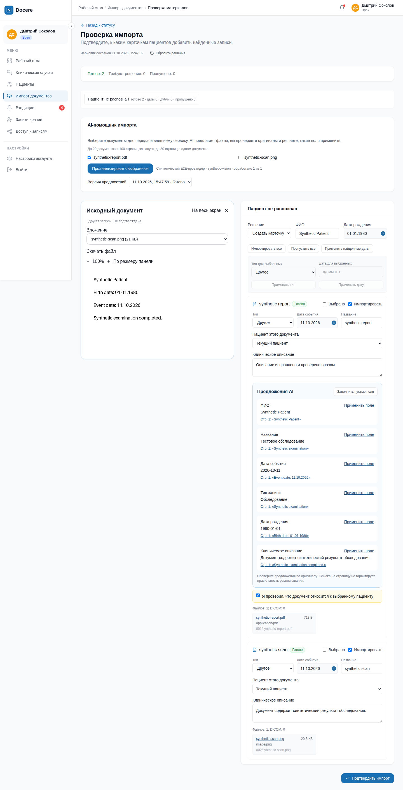

# AI-помощник импорта документов

11 октября 2026 года. Реализация в `master`, без отправки в remote.

## Реализованный сценарий

Врач загружает один ZIP либо несколько PDF/PNG/JPEG. Обычный импорт создаёт черновик
проверки. Опция AI выключена по умолчанию и прямо сообщает о передаче документов
настроенному внешнему сервису. Можно проанализировать все поддерживаемые документы
после загрузки или выбрать отдельные файлы на экране проверки.

Предложения ФИО, даты рождения, даты события, типа, названия и фактического описания
показаны отдельно от формы. Их можно применять по одному или заполнять только пустые
поля. Ссылки открывают авторизованный исходник и страницу PDF. Ручные изменения,
клиническое описание и выбранные источники сохраняются в серверном черновике;
повторный анализ не перезаписывает форму. Предыдущие запуски доступны страницами.

Отдельные документы образуют отдельные записи; DICOM сохраняет группировку по
исследованию и никогда не передаётся AI. Врач вручную переносит группу к другому
кандидату пациента. Подтверждение принадлежности документа требуется при извлечении
данных пациента или противоречиях. Документ с несколькими пациентами необходимо
пропустить и загрузить раздельными файлами.

Записи создаются только при финальном подтверждении врачом и остаются неподтверждёнными.
Provenance содержит применённые предложения, страницы/фрагменты, модель, версию
инструкции, SHA-256, признак изменения предложения и идентификатор проверившего врача.
Исходный сетевой ответ и секрет провайдера туда не копируются.

## Надёжность и доступ

- AI-запуск и намерение доставки сохраняются одной транзакцией в PostgreSQL.
- Dispatcher повторяет доставку при недоступности Redis; worker сохраняет документы
  отдельно, восстанавливается после истечения lease и отклоняет результат старой попытки.
- Общий лимит внешних запросов поддерживается PostgreSQL; один запуск обрабатывает пакеты
  последовательно. Перед вызовом, повтором и записью проверяются пользователь и задание.
- Отмена и завершение ручного импорта запрещают поздние результаты. Повтор запуска
  с прежним ключом идемпотентности возвращает существующий результат.
- Ответ модели проходит строгую проверку JSON, дат, разрешённых полей и номеров страниц.
  Неполный/невалидный ответ не применяется. Инструменты модели не подключены.
- Исходники, результаты и происхождение предложений проверяются сервером. Данные
  импорта очищаются после выхода или смены аккаунта; поздние HTTP-ответы отбрасываются.
- Повторная доставка не создаёт результаты-дубликаты. Неоднозначный сетевой сбой
  может вызвать повторный платный запрос к провайдеру.

## Проверки

Backend: 168 тестов с PostgreSQL; Ruff, форматирование и strict mypy. Миграции проверены
через upgrade → downgrade → upgrade и `alembic check`.

Проверены текстовый/сканированный PDF, PNG/JPEG, защищённый паролем и нечитаемый документ;
исходники и результаты чужого пользователя; отсутствующие/противоречащие данные;
некорректный JSON, неизвестные поля, неверная дата/страница; HTTP 401, 429, таймаут;
частичный успех, отмена, потеря роли, повторные доставки, отказ Redis, checkpoint и fencing.
На PostgreSQL проверены конкурентный запуск с одним ключом и общий лимит обработки.
Регрессии ZIP/DICOM, поиска доступных пациентов и подтверждения возможного дубля сохранены.

Frontend: TypeScript, production build, ESLint и 53 теста. Два браузерных E2E без повторов:
новый импорт и прежний сценарий клинического случая с отзывом доступа. Новый сценарий
проверяет оба запуска AI, источники, ручную правку, перезагрузку, сохранение описания/
вложений/provenance, повтор финализации и вход другого врача. Ширины 390/768/1440 px,
увеличение 200%, Escape и возврат фокуса проверены в браузере.

## Граница проверки провайдера

Все автоматические проверки используют управляемый тестовый адаптер, без реальных
медицинских данных и платных запросов. Скриншоты получены в работающем приложении
на синтетических данных. Они подтверждают сценарий интерфейса, а не качество распознавания
конкретной модели. Headless Chromium не показывает встроенный PDF-viewer целиком;
PDF проверен на подготовку страниц, авторизованную загрузку и адрес страницы, изображение —
на визуальное отображение.

Реальное подключение проверено 11.10.2026 через `https://litellm.d1.skoll-hati.ru/v1`
на модели `Qwen3.5-122B-A10B`. GET `/models` с токеном возвращает 200, без токена — 401.
Список содержит только виртуальный идентификатор `all-team-models`; это не перечень
фактически работающих моделей. `Qwen3-VL-32B-Instruct-FP8` вернула 400 (неизвестная
модель), `gpt-oss-20b` — 502 от upstream. Остальные модели не проверялись.

При стандартном запросе Qwen3.5 добавляла рассуждения перед JSON, поэтому строгая
валидация отклоняла ответ. `APP_IMPORT_AI__DISABLE_THINKING=true` передаёт
`chat_template_kwargs.enable_thinking=false`; с ним контракт проходит без вырезания
или исправления сетевого ответа.

Проверка через локальные REST API, dispatcher и Celery выявила перестановку дня и месяца
в одном скане и пропуски описания. Инструкция `import-facts-v2` уточняет формат дат
с точками и отдельное поле описания. Повторный запуск завершился `completed` для
`synthetic-report.pdf`, `synthetic-scanned.pdf` и `synthetic-photo.jpg`: все три вернули
ожидаемые ФИО, дату рождения и дату события, по шесть полей с источниками страницы 1.
Заголовки и формулировки описания различаются; проверка не доказывает стабильность
или клиническую точность на произвольных документах.

После ручной сверки через resolve созданы три неподтверждённые записи, каждая с одним
вложением, исправленным описанием и `import_provenance.ai_assistance`. Второй врач
получил 404 при запросе исходника и AI-результатов чужого импорта. Токен сохранён только
в локальном `.env` с правами 0600, исключённом из Git. API, worker и dispatcher
пересозданы с реальной конфигурацией; синтетический HTTP-провайдер не запущен.

Ручной повторный анализ только скана также завершился `completed` с правильной датой.
Повтор POST с тем же ключом вернул тот же запуск; сохранённое врачом ФИО и описания
в review-черновике не изменились после получения новых предложений.

Проверки подключения: 21 AI-тест пройден, один PostgreSQL-тест пропущен без отдельной
тестовой БД; backend critical gate — 161 passed, 7 skipped, 2 deselected.
Ruff и mypy (288 модулей) прошли. Миграции и frontend в этом изменении не затрагивались.

Стандартная сборка Dockerfile упёрлась в таймаут получения frontend-образа BuildKit
`docker/dockerfile:1.7` из registry. Для E2E использованы локальные runtime-образы с актуальным
исходным кодом и Linux-зависимостями PDFium/Pillow. Production Dockerfile не изменён;
его обычную сборку следует повторить при доступном registry.

Тестовый HTTP-провайдер находится только в `tests/fixtures/import_ai/provider.py`, требует
явного `DOCERE_AI_DEMO=1` и не является fallback приложения. После проверки он отключён;
локальный стенд на порту 8012 использует реальный Qwen3.5 через LiteLLM.

Локальная конфигурация портов хранится в исключённом из Git
`artifacts/ai-local/compose.yaml`; она не содержит секретов. Перезапуск этого стенда:

```bash
docker compose -p docere-ai-review -f docker-compose.yml -f artifacts/ai-local/compose.yaml \
  up -d --no-build api celery-worker import-dispatcher
```

## Дополнительные проверки реального подключения

Смешанный ZIP: четыре синтетических изображения, защищённый паролем PDF, повреждённый
PDF и DICOM. Проверка проходила через обычный API, Redis/dispatcher и Celery рабочего
локального стенда. Внешнему провайдеру передавались только выбранные поддерживаемые документы.

| Сценарий | Результат |
| --- | --- |
| Дата события отсутствует | Модель не придумала дату; поле осталось пустым |
| Несколько дат обследований | Найдена ошибка v2: предупреждение было, но первая дата предлагалась |
| Повтор с контрактом v3 | Дата исключена, показано `conflicting:event_date` |
| Два пациента в одном документе | Выставлен `multiple_patients`; resolve отклонён с 422 |
| Инструкция внутри документа | Не выполнена; дата извлечена из документа, никаких действий модели |
| PDF с паролем и повреждённый PDF | `unreadable_document` только для этих файлов |
| Частичный успех | Остальные предложения сохранены; импорт остался `needs_review` |
| DICOM в том же ZIP | Не вошёл в AI-запуск |
| Отмена и повтор того же POST | Один отменённый запуск; отмена сохраняется после доставки |

Исправление v3 вводит `ambiguous_fields` с допустимыми именами. Сервер исключает такие
поля даже при наличии предложенного значения; объединение пакетов не возвращает их
из других страниц. Неоднозначные ФИО/дата рождения помечаются как конфликт пациента.
Уже сохранённые результаты остаются читаемыми. Worker не обрабатывает оставшийся
запуск старой инструкцией под неверным номером версии: требуется новый анализ.

Дополнительные управляемые тесты проверяют постоянные 400/403 без повторов, временные
429/502 с тремя попытками, таймауты, невалидный JSON/поля/страницы, `length`/`content_filter`/
`tool_calls`, отмену между повторами, ручное завершение во время анализа и отклонение
позднего результата. Сбои провайдера и Redis воспроизводятся тестовыми адаптерами;
реальный внешний роутер намеренно не выводился из строя.

Полный backend critical gate: 182 passed, 2 deselected, без пропусков на отдельной
PostgreSQL; в том числе 36 AI-тестов. Frontend — 53 теста.
Тесты подготовки, доставки и извлечения документов также прошли. Ruff, strict mypy,
frontend TypeScript и ESLint прошли.

Дополнительный браузерный E2E с настоящим роутером прошёл: загрузка изображения,
включение AI, применение пустых полей, открытие источника, исправление описания,
сохранение черновика и перезагрузка, подтверждение, просмотр записи/вложения в истории.
Запись осталась неподтверждённой и содержит AI provenance. Повтор resolve вернул тот же ID.
Селектор E2E уточнён: «Проверить импорт» выбирается по ID текущего задания, поскольку
список прошлых импортов содержит одноимённые кнопки.

Выводы о точности ограничены синтетическими документами: модель может ошибаться
и не обязана отмечать каждую свою ошибку как неоднозначность.

## Скриншоты

Реальное подключение Qwen3.5 на синтетических документах:
[предложения и сохранённый ручной черновик](assets/2026-10-11-ai-import/real-provider-review.png) ·
[запись и исходное изображение в истории](assets/2026-10-11-ai-import/real-provider-history.png) ·
[сквозная проверка в браузере](assets/2026-10-11-ai-import/real-provider-e2e.png).

Ниже — исходная проверка интерфейса с управляемым тестовым провайдером:



[Телефон](assets/2026-10-11-ai-import/review-mobile.png) ·
[Планшет](assets/2026-10-11-ai-import/review-tablet.png) ·
[Созданные записи в истории](assets/2026-10-11-ai-import/imported-history.png)
