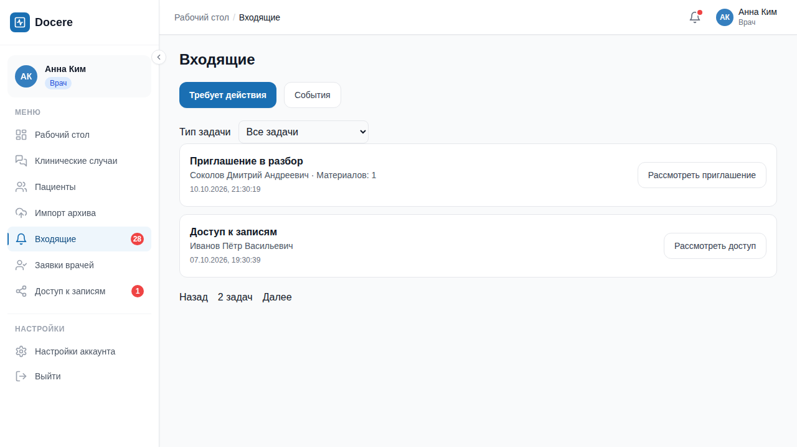

# Входящие → материалы → итог: реализованный UX-пакет

11 октября 2026 года. Изменения внесены локальными коммитами непосредственно в `master`.

## Что доступно

- «Входящие» объединяют приглашения, открытые запросы мнения, независимый sharing
  и собственные архивы на проверке. События и их прочтение находятся в отдельной вкладке.
- Рабочий стол показывает пять задач; колокольчик раздельно показывает действия
  и непрочитанные события. Фильтры и страницы сохраняются в URL. Ошибка обновления
  не превращается в ложный нулевой счётчик.
- История и случай используют общий защищённый просмотрщик PDF/PNG/JPEG. Для изображений
  доступен масштаб, для всей панели — полноэкранный режим, для любого формата — скачивание.
- Прямые ссылки открывают нужный материал, адресный запрос или опубликованную запись.
  История проверяет принадлежность записи пациенту, case API сохраняет полную case ACL.
- Последняя версия итога показана первой; история раскрывается отдельно. Источники имеют
  названия и даты. Расхождение с личным черновиком требует явного выбора при завершении.
- Публикация сохраняет дату события и существующую идемпотентность. Доступ и подтверждение
  опубликованной записи автоматически не выдаются.

## Проверка

Полный backend gate: 146 тестов с PostgreSQL, включая архитектуру, конкурентные изменения
и миграции. Четыре теста очереди проверяют состав задач, изоляцию и отображаемые источники;
один из них выполняет SQL UNION на PostgreSQL в изолированной схеме. Регрессия уведомлений
проверяет серверный фильтр непрочитанных событий. Ruff, mypy и pre-commit прошли.

Frontend: TypeScript, production build, ESLint и 49 тестов. Проверены отмена устаревшего
ответа документа, уничтожение Blob URL, неправильный пациент, выбор версии перед завершением
и отклонение ответа счётчиков предыдущей сессии.

Два E2E без повторов: полный сценарий двух врачей с посторонним пользователем и отзывом
открытого документа; отдельно клавиатурное управление и CSS-увеличение интерфейса до 200%.
Основной сценарий проверяет ширины 390, 768 и 1440 px без горизонтального переполнения.
Полноэкранный просмотр закрывается по Escape и возвращает фокус. Скриншоты получены
реальными тестами на синтетических данных; это не полный аудит доступности или исследование
с реальными врачами.

## Ограничения

Точный подсчёт очереди повторно проверяет кандидатов ограниченными порциями. Для больших
очередей потребуется пакетная оптимизация ACL; текущий алгоритм не загружает всю очередь
в память. PDF использует браузерный просмотрщик. Новая система событий, AI, OCR и DICOM
в этот пакет не входят. Безусловного обещания мгновенного отзыва уже скачанного файла нет;
открытая панель перепроверяется при возвращении фокуса, а случай — также через SSE.

Стенд: http://localhost:8012. README и ARCHITECTURE описывают API и поведение.

## Скриншоты

[Документ рядом с обсуждением](assets/2026-10-11-inbox/case-document.png) ·
[Итог на телефоне](assets/2026-10-11-inbox/conclusion-390.png) ·
[Итог на широком экране](assets/2026-10-11-inbox/conclusion-1440.png) ·
[Увеличение до 200%](assets/2026-10-11-inbox/inbox-200-percent.png)

Следующий продуктовый этап: первый вход врача и проверка сценария с врачами.
Следующая AI-функция: сводка выбранных материалов с проверяемыми ссылками; способ
размещения модели и обработки медицинских данных ещё предстоит определить.
