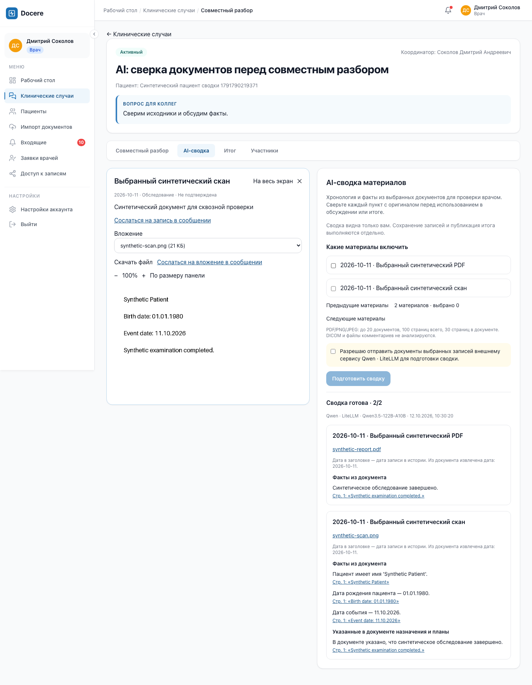
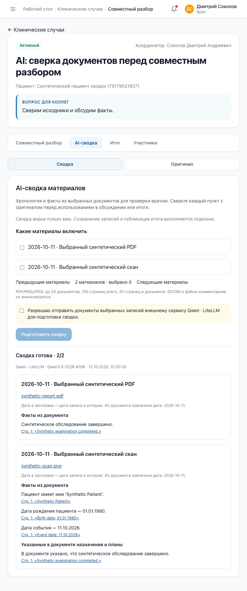
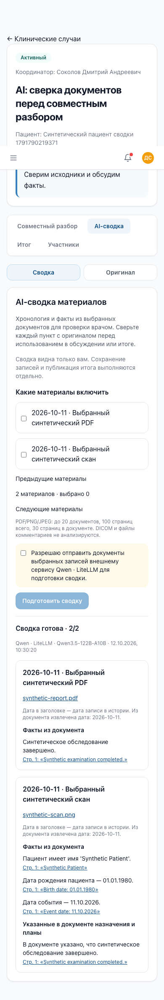

# Проверка личной AI-сводки клинического случая — 12 октября 2026

## Реализованный сценарий

Во вкладке «AI-сводка» врач явно выбирает материалы и подтверждает их передачу настроенному провайдеру. Поддерживаются прямые PDF/PNG/JPEG-вложения записей. DICOM, файлы комментариев, обсуждение и невыбранные материалы не отправляются.

Результат содержит факты, упомянутые в документе назначения, проблемы распознавания и ссылки на страницы оригиналов. Заголовки упорядочены по дате записи; извлечённая дата документа показана отдельно. Источник открывается через защищённый case API. На телефоне панели «Сводка» и «Оригинал» переключаются, на широком экране видны рядом.

Сводка личная: другой участник создаёт собственную. Она не записывается автоматически в итог или историю пациента. Для чтения и продолжения обработки обязательны активный врач, членство и доступ ко всем материалам случая. Изменение исходников делает старую сводку недоступной до повторного анализа.

## Проверки

- Backend critical gate: **197 passed, 2 deselected**; отдельная PostgreSQL, включая конкурентный запуск, общий лимит AI-обработки, цикл upgrade/downgrade/upgrade и сверку схемы с моделями.
- Строгий mypy: **297 модулей**, без ошибок; Ruff check и format check прошли.
- Frontend: **58 тестов**, TypeScript/build и ESLint прошли.
- Playwright с реальным настроенным Qwen3.5-122B-A10B: **1 сквозной тест прошёл**. Только синтетические PDF и PNG, два врача и посторонний пользователь.
- Сквозной сценарий: выбор и согласие → анализ двух документов → оригинал и страница источника → восстановление после reload → личный анализ второго врача → ответ в обсуждении → ручной итог → закрытие → публикация с отдельной датой события → идемпотентный повтор → отзыв доступа. При отзыве исчезли открытый оригинал и сводка, API вернул 404.
- Проверены ширины **390, 768 и 1440 px**, отсутствие горизонтального переполнения и мобильный переход к источнику с возвратом к сводке.
- Автоматические проверки также покрывают неправильный JSON/страницы, неоднозначные даты, разных пациентов в пакетах страниц, повторяющиеся факты, частичный успех, отмену, поздний worker, восстановление lease, недоступность Redis и изменение источника.

Отдельная проверка реального извлечения на пяти синтетических документах описана в [отчёте импорта](2026-10-11-ai-extraction-evaluation.md).

## Надёжность и ограничения

Намерение запуска хранится в PostgreSQL вместе с результатами отдельных документов. Dispatcher повторяет доставку через Celery/Redis; lease и токен worker блокируют позднюю запись. Импорт и сводки используют общий лимит внешней обработки. HTTP-ответы сводки имеют `Cache-Control: private, no-store`. Секрет провайдера остаётся в локальной конфигурации и не попадает в браузер, исходный код или технические логи.

После неоднозначного сетевого сбоя платный вызов провайдера может повториться, хотя результаты не дублируются. Ссылка на источник подтверждает происхождение, а не правильность интерпретации. Даже на синтетическом документе модель может неточно выбрать категорию факта; врач сверяет оригинал. Эти проверки не доказывают клиническую точность на произвольных медицинских документах. Оценка реальными врачами и отдельная проверка доступности при увеличении браузера 200% остаются последующими задачами.

## Настоящие скриншоты синтетического сценария

### Оригинал и сводка рядом — 1440 px

### Планшет — 768 px

### Телефон — 390 px

## Повторный запуск E2E

Опциональный тест `frontend/e2e/case-ai.spec.ts` требует явно установленного `DOCERE_REAL_AI_E2E=1`, локального демо-стенда, синтетических аккаунтов и работающего провайдера. Без этого флага тест пропускается. Он создаёт новые синтетические объекты и выполняет внешние вызовы; использовать только демонстрационное окружение. `seed-demo` для повторного запуска не требуется.
