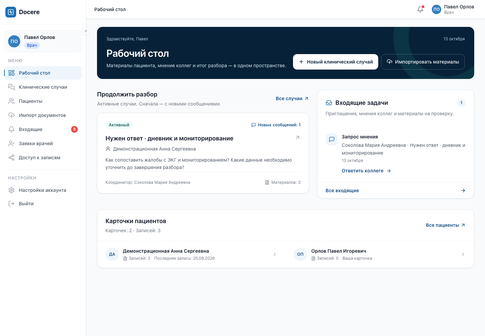

# Рабочий стол врача: продуктовый пакет 13 октября 2026

Рабочий стол теперь ведёт к конкретному действию: ответить на входящую задачу,
продолжить разбор или начать с карточки пациента. Цвета Docere, системный шрифт,
серверные данные и проверка доступа сохранены.

## Что изменено

- Вводный блок стал компактнее; создание случая и импорт доступны сразу.
- Вместо двух очередей показаны единые серверные входящие: до пяти задач,
  полный серверный счётчик и переход ко всем входящим. Запрос мнения ведёт прямо
  на соответствующую вкладку и запрос. Повторная загрузка доступна с клавиатуры.
- При обновлении входящих старые задачи и счётчик скрываются до текущего ответа
  сервера, регион помечен `aria-busy`. Смена аккаунта и выход очищают локальный
  контекст; ответы предыдущего запроса игнорируются. Ошибка явно показывается,
  первичная загрузка и пустое состояние различаются.
- «Продолжить разбор» показывает два активных случая; случаи с непрочитанными
  сообщениями выше среди полученных сервером кандидатов. Карточка приглашения
  продолжает скрывать клинический текст до принятия доступа.
- Крупные KPI заменены компактными реальными счётчиками возле карточек пациентов;
  собственная карточка явно подписана. На главной показываются до четырёх карточек.
- Ошибки и предупреждения импорта остаются отдельным блоком со ссылками на результат;
  архив на проверке показывается только в единой очереди.
- Для нового врача показаны три шага: пациент → материалы → обсуждение.
  Наличие собственной карточки не считается началом работы с пациентами;
  пустой блок случаев объясняет следующий шаг без преждевременного создания случая.

Меняются только `DoctorDashboard.tsx`, `RecentCases.tsx`, новый локальный
`DashboardInbox.tsx` и собственный `ProductDashboard.test.tsx`. API, backend,
общая карточка случаев, глобальные стили и layout не менялись.

## Проверка

- Scoped ESLint для четырёх файлов прошёл.
- TypeScript type-check прошёл после исправлений ревью.
- Полные `npm run lint` и `npm run build` повторно прошли после исправлений
  входящих (13 октября, 12:23 MSK), без warnings.
- `npm run test -- src/pages/dashboard/ProductDashboard.test.tsx src/pages/dashboard/Onboarding.test.tsx`:
  **31 тест прошёл**, включая десять новых проверок рабочего стола.
- Проверены отсутствие дубля архива, ссылка на проблему импорта, onboarding при
  собственной карточке, загрузка/ошибка/повтор, клавиатура, игнорирование устаревшего
  ответа, скрытие контекста при отзыве доступа/выходе/смене аккаунта, первые пять
  задач и нейтральное представление закрытого приглашения.
- Настоящий Chromium на общем изолированном стенде (`127.0.0.1:4174`, API `localhost:8012`):
  заполненный рабочий стол коллеги и первое посещение врача с собственной карточкой
  проверены на **390, 768, 1440 px**. На всех размерах `scrollWidth === innerWidth`.
  После стабилизации layout снимки визуально просмотрены; текст и основные действия
  помещаются, при узком экране входящие стоят перед активными случаями.
- Tab переводит фокус из заголовка на основное действие, затем на импорт;
  Enter открывает `/upload` для обеих конфигураций. Ошибок JavaScript не получено.
- Общий frontend gate, ранее выполненный `product_journey`, повторно выполнен
  после коррекции входящих; владельцам сообщено о стабилизации файлов.

Все сведения на скриншотах синтетические и получены от реального API. Для финальных
снимков использован demo-run `20261013091356-8a343d28`; сценарий не сбрасывался.

## Снимки

| Состояние | 1440 px | 768 px | 390 px |
|---|---|---|---|
| Заполненный рабочий стол | [Desktop](assets/2026-10-13/product-dashboard/populated-1440.png) | [Tablet](assets/2026-10-13/product-dashboard/populated-768.png) | [Mobile](assets/2026-10-13/product-dashboard/populated-390.png) |
| Первое посещение врача | [Desktop](assets/2026-10-13/product-dashboard/empty-1440.png) | [Tablet](assets/2026-10-13/product-dashboard/empty-768.png) | [Mobile](assets/2026-10-13/product-dashboard/empty-390.png) |

## Границы проверки

Это экспертная проверка интерфейса и синтетических сценариев, не исследование
с реальными врачами. Сортировка двух активных карточек действует внутри первой
страницы существующего API (до 20 кандидатов), а полный список доступен по ссылке.
Счётчики карточек и записей относятся только к пациентам, доступным текущему врачу.
